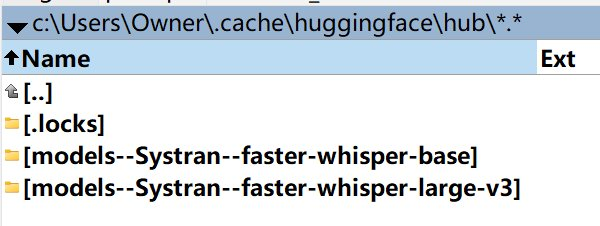
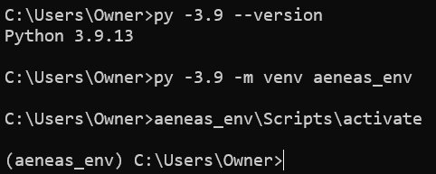

# Install
先安装好python 3.11，ffmpeg
```
python --version
Python 3.11.9
```
安装faster whisper,
```
pip install faster-whisper
```
faster whisper 不需要装pytorch, `openai/whisper` 原版要装
PyTorch 是一个 **深度学习框架**，主要用来：
- 训练神经网络（模型怎么学）    
- 加载/运行很多 AI 模型（尤其是研究圈）    
- 管理 GPU 显存、反向传播这些底层活
# How to use
写简单的python脚本
```python
from faster_whisper import WhisperModel

# 第一次会自动下载模型
model = WhisperModel("base", device="cpu")

segments, info = model.transcribe("test.mp3")

print("语言:", info.language)
print("概率:", info.language_probability)

for segment in segments:
    print(f"[{segment.start:.2f}s -> {segment.end:.2f}s] {segment.text}")
```
运行：
```
python .\whisper_test.py
```
第一次运行会自动下载模型，下载到了
```
c:\Users\Owner\.cache\huggingface\hub\
```


# whisperx，推荐
```
# uninstall
pip uninstall -y whisperx

pip install whisperx
pip show whisperx
```
whisperx 3.7.4 + torch v2.8

测试老版本：
```
# 卸载
pip uninstall -y torch torchaudio torchvision
# 安装torch v2.5.1 cpu version
pip install torch==2.5.1 torchaudio==2.5.1 torchvision==0.20.1
```

# aeneas
安装python v3.9, 勾选 **Add Python to PATH**
安装后验证：
```
py -3.9 --version
where python
```
创建虚拟环境
```
py -3.9 -m venv aeneas_env
# 激活
aeneas_env\Scripts\activate
```

```
# 升级 pip
python -m pip install --upgrade pip setuptools wheel
# 安装 numpy
pip install numpy==1.23.5
# 验证：
python -c "import numpy; print(numpy.__version__)"
```
numpy 1.23.5:
- ✔ 对 Python 3.9 稳定    
- ✔ 与 Aeneas 兼容最好    
- ✔ 避免编译
```
# 设置环境变量, 禁用 Aeneas 的 C 扩展，走纯 Python 模式
set AENEAS_WITH_CEW=False
set AENEAS_WITH_CDTW=False
set AENEAS_WITH_CMfcc=False
set AENEAS_WITH_CWAVE=False
# 启用当前虚拟环境里的 numpy，安装aeneas
pip install aeneas --no-build-isolation
# 验证aeneas
python -m aeneas.tools.execute_task --help
```
测试发现：
aeneas 的核心假设是「朗读语音」aeneas 的算法模型假设：
- 语速稳定    
- 句子清晰    
- 停顿 ≈ 标点    
- 没有拉长音、转音、节拍
测试失败。