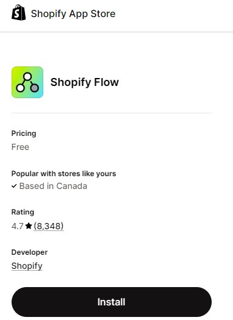
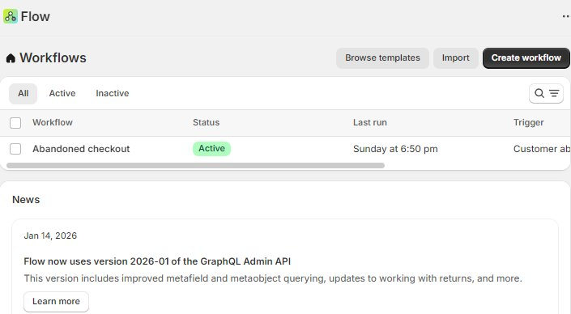
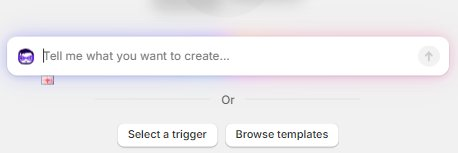
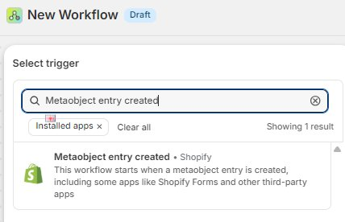
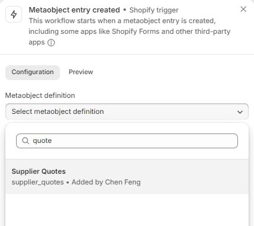
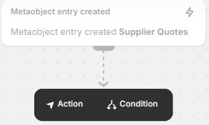
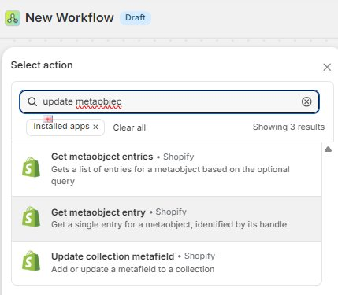

# auto workflow 
用第三方邮件服务 + .NET
例如：
- SendGrid    
- Amazon SES    
- Mailgun
# Shopify workflow (official app)
Shopify Flow 的三个核心概念
- **Trigger (触发器)**：发生了一件什么事？（例如：创建了新的 Metaobject 条目）。    
- **Condition (条件)**：这件事满足什么要求吗？（例如：Supplier 字段不是空的）。    
- **Action (操作)**：机器人该做什么？（例如：把产品名称复制到 Display Name 字段）。

app > shopify flow > create workflow > select a trigger

select an action

turn on

除了同步 Metaobject，workflow在日常运营中非常强大：

|**场景**|**自动化逻辑**|
|---|---|
|**库存预警**|**如果** 库存低于 5，**那么** 发送 Slack 或邮件通知采购。|
|**高风险订单**|**如果** 系统判定订单风险高，**那么** 自动取消订单并退款。|
|**客户分层**|**如果** 客户单笔消费满 1000 元，**那么** 自动给客户加上 "VIP" 标签。|
|**产品发布**|**如果** 产品状态变为 Active，**那么** 自动将其推送到特定的 Metaobject 列表。|
# 我创建产品的时候，配置1个variant 颜色，有2个值：黑色，金色。
每个颜色上传了5张图片。
用户可否点击颜色的时候，自动过滤出各自的颜色图片。

Shopify 推出了一个官方免费插件：**Shopify Combined Listings**（仅限 Plus 商家）或更通用的 **Shopify Search & Discovery**。
不过，针对“变体图片分组”，官方最直接的工具是： **[Shopify Combined Listings](https://www.google.com/search?q=https://apps.shopify.com/shopify-combined-listings)** * **原理**：它允许你将不同的产品组合成一个父产品。每个子产品（颜色）拥有自己独立的图片库。

- **优点**：官方支持，不影响加载速度。    
- **缺点**：目前主要针对 Shopify Plus 商家开放。
# 其他
Ablestar Bulk Product Editor
https://apps.shopify.com/bulk-product-editor?st_source=autocomplete&surface_detail=autocomplete_apps
Matrixify
https://apps.shopify.com/excel-export-import?st_source=autocomplete&surface_detail=autocomplete_apps
Mechanic

