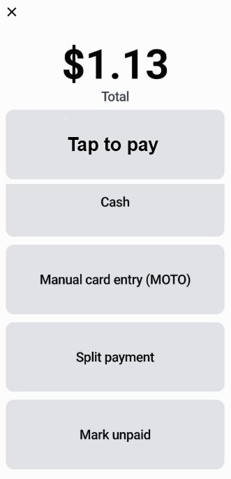
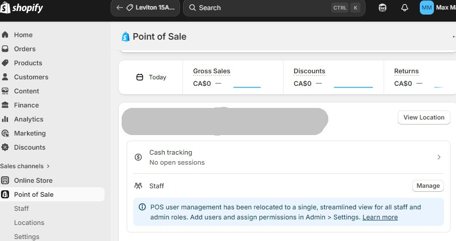
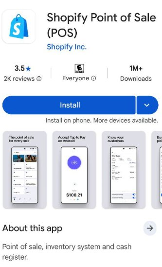
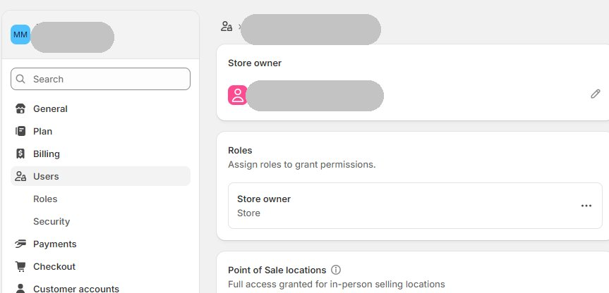

# Introduction
## POS 的核心运作流程
1. **录入：** 客户拿了一件商品，你用手机 App 或 iPad 扫描条码。    
2. **计算：** 系统自动调取 Shopify 后台的价格、促销活动（比如买二送一）。    
3. **支付：** 客户刷卡或扫码。POS 软件向银行发出请求并确认扣款成功。    
4. **同步：** 系统会即时更新你的 **Shopify 库存**，并生成一份订单记录。    
5. **离场：** 打印收据或发送邮件，交易完成。

一个完整的 POS 系统由三部分组成：**软件、硬件、后台数据**。
### 软件 (The Brain)
这是你操作的界面。
- **功能：** 扫描商品、计算折扣、应用税率、处理退款。    
- **Shopify POS：** 作为 Basic 用户，你自带了 **Shopify POS Lite** 版本。这意味着你的线上网站和线下 POS 共用一个后台。你在店里卖掉一件衣服，网站上的库存会自动减 1。   
### 硬件 (The Body)
这是你摸得着的东西。
- **终端/平板：** 现在主流是 iPad 或安卓平板。    
- **读卡器 (Card Reader)：** 刷信用卡、感应 Apple Pay。    
- **条码扫描枪：** 快速录入商品。    
- **收据打印机：** 虽然现在流行发电子邮箱收据，但纸质版依然是标配。    
- **钱箱：** 存放现金。    
### 后台云端 (The Memory)
所有的交易数据都会上传到云端。你可以随时在手机上看到：“今天下午 3 点，店里卖得最好的是哪款产品？”
## Shopify POS 
Shopify POS 的核心逻辑是：**一个后台（Admin），管理线上（Online Store）和线下（Retail）所有的库存、客户和订单。**
Shopify   POS 软件分为两个版本。
### Shopify POS Lite（基础版）
- **成本：** 包含在你的 **Shopify Basic** 订阅中（**$0/月**）。    
- **适用场景：** 偶尔参加市集、快闪店（Pop-up）、或小型工作室。    
- **核心功能：** 基础库存管理、客户资料收集、通过移动设备接受支付、基础订单报告。    
### Shopify POS Pro（专业版）
- **成本：** 每个地点（Location）约 **$89/月**；或者basic plan + pos pro = $119/m
- **适用场景：** 拥有固定员工、高客流量的正式实体店。    
- **进阶功能：** * **店内自提（Buy online, pick up in store）：** 线上买，线下取。    
    - **员工权限管理：** 为不同店员设置不同的操作权限。        
    - **智能库存管理：** 自动生成补货建议、跨店调拨。        
    - **无限数量的注册终端：** 一个店里放 10 台 iPad 也没问题。
# Hardware
Shopify 的硬件设计非常简洁（通常是白色或黑色），且与软件原生适配。
https://hardware.shopify.com/en-ca
https://www.shopify.com/ca/pos/hardware
## 核心支付设备 (Payment Hardware)

| **设备名称**                        | **核心功能**                                                      | **预估价格 (2026)** | 交易收费                                                 | **适合场景**    |
| ------------------------------- | ------------------------------------------------------------- | --------------- | ---------------------------------------------------- | ----------- |
| **Tap to Pay** iPad 或 iPhone | **无需硬件**。 手机安装 Shopify POS App ,直接利用 iPhone 或安卓的 NFC 感应收钱。 | **$0** (仅需手续费)  | 2.7% + $0 (Basic)   2.4% + $0 (Advanced and Plus) | 极简起步、移动摊位   |
| **WisePad 3**                   | 小型蓝牙读卡器，支持插卡 (Chip) 和感应 (Tap)、NFC。带数字键盘。                      | **$69**         |                                                      | 快闪店、小型工作室   |
| **Shopify POS Go**              | **旗舰级掌上终端**。自带高清屏幕、扫码头和读卡器。像一台加厚的手机。                          | **$349 - $399** |                                                      | 店员流回收银、中型门店 |
| **POS Terminal**                | 台式一体机屏幕，面向客户展示交易金额和签字界面。                                      | **$459 - $499** |                                                      | 固定收银台、高端零售店 |
如果你在支持的国家（如美/英/加），你可以使用 **Tap to Pay on iPhone**。**无需额外硬件**，客户直接把卡贴在你个人的 iPhone 上就能结账。
## Tap to Pay
#### NFC
**NFC** 的全称是 **Near Field Communication**（近场通信）。简单来说，它是一种**短距离无线连接技术**，允许两个设备在极近的距离内（通常在 **4 厘米**以内）交换数据。
你可以把它想象成一种“超近距离、秒连接”的蓝牙。
- **它的核心用途：** * **非接触支付：** 比如 Apple Pay, Google Pay, 刷手机乘公交。    
    - **设备配对：** 手机碰一下蓝牙音箱自动连接。        
    - **标签读取：** 碰一下 NFC 贴纸，手机自动静音或打开某个网页。        
    - **数据交换：** 两台手机碰一下传个联系人。

NFC Tag 是一个**“可以被手机感应的电子贴纸”**。它是一种非常薄、通常像硬币大小的贴纸或卡片，内部包含一个微小的芯片和天线。
- **它不需要电池：** 它的能量来自靠近它的手机。    
- 能反复使用。支持 10 万次左右的擦写。可以今天写入你的官网链接，明天擦掉换成优惠券代码。
- 锁定功能： 如果你不想别人改动它，可以在写入时选择 “Lock” (锁定)。一旦锁定，它就变成了“只读”，再也无法修改（除非是物理损毁）。
- **它的功能：** 它的唯一任务就是存储一小段信息（比如一个网址链接）。当手机靠近它时，手机会自动弹出这个链接。
- - **非标配硬件：** 它属于“耗材”。你需要去亚马逊或批发平台购买（很便宜，几毛钱一个）。    
- **需要自行“写入”：** 刚买回来的 NFC Tag 是空的。你需要用手机下载一个叫 **“NFC Tools”** 的 App，把你的 Shopify 商品链接“写”进去。
NFC Tag通常写入文字、网址。它的内存是以 **“字节 (Bytes)”** 计算的，而不是 MB 或 GB。2026 年主流的芯片规格如下：

| **芯片型号**    | **用户可用内存** | **存储能力参考**                      | **价格 (估算)**     |
| ----------- | ---------- | ------------------------------- | --------------- |
| **NTAG213** | **144 字节** | 约 130 个字符（短网址） 可以用短网址 bit.ly | 最便宜，普及率最高       |
| **NTAG215** | **504 字节** | 约 490 个字符（复杂的电子名片）              | 任天堂 Amiibo 专用型号 |
| **NTAG216** | **888 字节** | 约 850 个字符（一小段长文本）               | 稍微贵一点           |
为了能显示大量数据，甚至图片，可以把图片上传到 Shopify 图片库或图床，然后在 NFC 标签里写入该图片的链接 (URL)。这样客户一碰，手机浏览器就会瞬间打开那张高清大图。

除了文字和网址，NFC 还可以执行一些 **“指令”**：
- **无线连接：** 写入 Wi-Fi 名称和密码，客户一碰自动连网。    
- **动作指令：** * 自动拨打某个电话。    
    - 自动发送一条写好的短信（如：“我想咨询这款产品”）。        
    - 自动打开地图并导航到你的线下店。        
- **社交媒体：** 直接跳转到 Instagram 关注页面或 WhatsApp 聊天窗口。    
- **电子名片 (vCard)：** 姓名、电话、邮箱一碰自动存入手机通讯录。
#### NFC支付对买卖双方的要求：
iphone: https://help.shopify.com/en/manual/sell-in-person/shopify-pos/payment-management/tap-to-pay-iphone
android: https://help.shopify.com/en/manual/sell-in-person/shopify-pos/payment-management/tap-to-pay-android
卖家/收款方：必须**满足硬件和系统要求：
- **设备：** iPhone XS 或更新机型，或者支持 NFC 的安卓手机（如你提到的 S21 FE, A16）。    
- **系统：** iOS 16+ 或 Android 10+。    
- **软件：** 安装 **Shopify POS App**。    
- **账号：** 必须激活 **Shopify Payments**（目前该功能在美、加、英、澳及部分欧洲国家可用）。
客户（买家/付款方）：不需要安装任何特定 App，也不需要满足特定的系统版本。
- 手机有钱包功能（Apple Pay/Google Pay/Samsung Pay）
- 银行卡支持闪付，印有“无线波纹”标志（像横着的 Wi-Fi 信号）的**信用卡或借记卡
#### 支付流程
即便没有额外的读卡器，只用一部手机也能收钱：
1. **添加商品：** 在卖家的手机上打开 **Shopify POS App**，把客户要买的东西加入购物车。    
2. **点击结算：** 点击屏幕下方的 **"Checkout"（结账）**。    
3. **选择支付方式：** 在支付选项中选择 **"Tap to Pay on iPhone"** (或 Android)。    

- **Top to pay：** NPC支付
- **Cash (现金)：** 
- **Manual card entry (手动录入)：** 这是让你手动输入客户卡号、CVV 码。**注意：** 这种方式的手续费最高（等同于线上交易），且有拒付风险。    
- **Split payment (拆分支付)：** 客户一部分付现金，一部分付别的。    
- **Mark unpaid (标记未付)：** 先下单，稍后付款。

1. **展示感应区：** 你的手机屏幕会显示一个提示，告诉客户在哪里贴卡。    
    - _iPhone：_ 感应区通常在手机顶部的听筒附近。        
    - _安卓：_ 感应区通常在手机背面的中心或顶部。        
2. **靠近感应：** 客户将卡片或手机贴近你的感应区。    
3. **交易完成：** 听到“叮”的一声，屏幕显示“Payment Approved”，你可以通过邮件或短信给客户发收据。

注意：
1. **PIN 码问题：** 有时候金额较大（超过免密限额），App 可能会提示客户在你的手机屏幕上输入支付密码（PIN），这是正常的安全校验。
	银行卡（刷实体卡）：
	- **英国：** 超过 **£100**（目前正计划在 2026 年进一步上调或由银行自主决定）。    
	- **欧洲（欧元区）：** 通常超过 **€50** 需要输入 PIN。    
	- **美国：** 相对宽松，通常 **$100 - $200** 以上才需要签名或 PIN，甚至部分商户免签。    
	- **土耳其：** 2026 年最新标准为 **2,500 里拉**。
	手机支付**（Apple Pay / Google Pay）：**
	- **几乎没有限额：** 这是一个关键点！因为手机支付已经通过了你的**生物识别（面容 ID 或指纹）**。即使支付 $1,000，只要手机认证过了，通常不需要在 POS 终端再次输入 PIN。
2. **中国地区限制：** 需要注意的是，**Shopify Payments 目前不支持中国大陆地区**。如果你在中国境内经营，无法直接开启“手机变读卡器”的功能。你可能需要借助第三方支付网关（如 Stripe 的特定服务）或扫码支付（支付宝/微信）。
## 柜台配套设施 (Countertop Hardware)
如果你有固定店面，需要这些外设来提升专业度。
- **iPad 支架 (Retail Stands)：**    
    - **特点：** 可 180° 旋转，方便客户签字；自带充电接口，保持 iPad 始终有电。        
    - **价格：** 约 **$149 - $195**。        
- **收据打印机 (Receipt Printers)：**    
    - **特点：** 支持蓝牙、Wi-Fi 或有线连接，自动出小票。2026 年主流型号（如 Star Micronics）支持静音高速打印。        
    - **价格：** 约 **$299 - $379**。        
- **扫码枪 (Barcode Scanners)：**    
    - **特点：** 虽然手机能扫码，但专业蓝牙扫码枪（如 Socket Mobile）在处理大量库存时速度快 10 倍。        
    - **价格：** 约 **$199 - $369**。        
- **钱箱 (Cash Drawers)：**    
    - **特点：** 由打印机驱动，结账时自动弹开。        
    - **价格：** 约 **$129 - $159**。
## 硬件套餐 (Bundles) 
Shopify 通常提供组合套餐，比单买便宜 10% 左右：
移动套餐 (Mobile Bundle): WisePad 3 + 保护套。适合经常换地方的卖家。
基础柜台套餐 (Starter Kit): iPad 支架 + WisePad 3。适合小型精品店。
全能零售套餐 (Retail Bundle): 支架 + 打印机 + 钱箱 + 扫码枪。一套搞定大店。约 $1,000 - $1,300。
# Pos Lite
- **成本：** 包含在你的 **Shopify Basic** 订阅中（**$0/月**）。    任何收费plan都自动包括lite，免费。连 $7的starter plan都包括。
- **适用场景：** 偶尔参加市集、快闪店（Pop-up）、或小型工作室。
- **核心功能：** 基础库存管理、客户资料收集、通过移动设备接受支付、基础订单报告。
流程：
1. **准备环境：** 在 Shopify 后台点击 **Point of Sale** 渠道，确认你的“位置”（Location）设置正确。   

2. **上架产品：** 在产品编辑页，勾选 **"Point of Sale"** 作为销售渠道（Sales Channels）。    
3. **下载 App：** 在 iPad 或手机安装 **Shopify POS**。手机打开nfc，蓝牙。

4. 创建PIN > login shopify.com > settings > users

5. **连接硬件：** 打开蓝牙，配对读卡器、 POS Go或terminal。    
6. **开始卖货：** 录入产品图片和价格，建议先给自己下一笔 $1 的订单测试流程。
# Pos Pro
- **成本：** 每个地点（Location）约 **$119/月**。    
- **适用场景：** 拥有固定员工、高客流量的正式实体店。    
- **进阶功能：** * **店内自提（Buy online, pick up in store）：** 线上买，线下取。    
    - **员工权限管理：** 为不同店员设置不同的操作权限。        
    - **智能库存管理：** 自动生成补货建议、跨店调拨。        
    - **无限数量的注册终端：** 一个店里放 10 台 iPad 也没问题。
# Reference
https://www.shopify.com/ca/pos/pricing
https://www.shopify.com/ca/retail/pos-system-cost

