# Collection
有2种 "Manual" 和 "Smart"，一个集合一旦创建，**不能**在 Manual 和 Smart 之间转换。如果选错了，只能删了重建。
## 默认的/all
Shopify 默认的 `/collections/all` 是不受控的。
它有几个重要特点：
- 默认排序规则**按 Product Title（A-Z）排序。**
- 为什么很多店铺看起来不是 A-Z: 因为 theme 或 URL 会改变排序：

| Sort                                        | 逻辑      |
| ------------------------------------------- | ------- |
| /collections/all?sort_by=best-selling       | 按销量     |
| /collections/all?sort_by=created-descending | 最新商品    |
| /collections/all?sort_by=price-ascending    | 价格低 → 高 |
| title-ascending                             | 默认A-Z   |
- `/collections/all` 其实 **不可直接配置**. Shopify admin 里 **看不到这个 collection**。所以很多 Shopify 开发者会**创建一个新的 collection 覆盖它。**
如果你想在全局隐藏 0 库存，你需要创建一个 **Handle 必须为 `all`** 的 Smart Collection，这样它就会覆盖系统的默认设置。
> 建议你先去创建一个 **Smart Collection**，名字叫 All Products，把 Handle 改为 `all`，条件设为 `Inventory stock is greater than 0`。这样你店里所有卖完的旧货就都会自动从列表里消失了。
例如
```
Collection name: All Products
Handle: all
Rule: Price > 0
```
然后设置排序：
```
Sort: best selling
```
## Collection 的核心作用
商品分类（最基本）
```
Tools
Fasteners
Electrical
Plumbing
Safety Equipment
```
网站导航 > 用户点击导航 → 打开 collection 页面。
```
Main Menu

Tools
Fasteners
Electrical
Plumbing
```
SEO Landing Pages
```
/collections/cordless-drills
/collections/stainless-steel-screws
```
营销活动 > 这些通常是 manual collection。
```
/collections/summer-sale
/collections/clearance
/collections/holiday-gifts
Spring Sale
Black Friday Deals
Clearance
Summer Essentials  
Winter Tools  
Back to School
```
Brand Collections（品牌）> SMART
```
Brand Collections（品牌）
```
规则：
```
title has Dewalt
Vendor = DeWalt
```
Collection 数量建议
```
小型店：10 – 20 collections
中型店：30 – 60 collections
大型店：100+
Collection 不要过度细分, 细分应该交给 filter。
```
## 最佳实践：
采用 **"Automated 为主，Manual 为辅"** 的架构设计：

| **集合名称**             | **类型**        | **配置逻辑 (Conditions / Usage)**     | **目的**     |
| -------------------- | ------------- | --------------------------------- | ---------- |
| **New Arrivals**     | **Automated** | `Product tag contains 2026`       | 展示最新收来的货   |
| **Used Power Tools** | **Automated** | `Type is Drill` AND `Tag is Used` | 基础分类导航     |
| **Clearance (清仓)**   | **Automated** | `Compare at price is not empty`   | 自动抓取所有打折商品 |
| **Home Page Hero**   | **Manual**    | 手动挑选 4-6 件最吸睛的工具                  | 首页橱窗展示     |
Smart Collection (自动集合) 只要能用逻辑描述的分类（如品牌、价格、库存状态），全部使用 Automated。
**常用组合：**
- **自动下架已售罄旧货：** 设置 `Inventory stock > 0`。    
- **按品牌自动归类：** 设置 `Product vendor is equal to Milwaukee`。    
- **高价值二手专区：** 设置 `Product tag is Used` AND `Product price > 200`。
Manual Collection (手动集合) — 仅用于无法通过系统属性归类、且具有时效性或主观审美要求的场景。
常用场景：
- **店长推荐 (Staff Picks)：** 你根据成色人工挑选出的 5 件性价比最高的旧电钻。    
- **维修服务/套装：** 比如你把一个旧机身、一个新电池、一个充电器手动凑成一个“套装”页面。    
- **线下捡漏 (In-store Only)：** 某些不适合邮寄、只能自提的特殊大件五金件。
# Product
## 添加产品
标题
- **公式：** `[品牌] + [型号] + [核心参数] + [新旧状态]`    
- **示例：** `Milwaukee 2904-20 M18 Fuel 1/2" Hammer Drill (Tool Only) - Refurbished`    
- **理由：** 这样在 Google 搜索和你的站内搜索中权重最高。
描述
- **Condition (成色):** 详细描述划痕、电池寿命。    
- **Includes (包含内容):** 是否带箱子、充电器。    
- **Specs (规格):** 电压、扭矩、转速。
其他
- **Vendor (供应商):** 填品牌名（如 Makita, Bosch）。    
- **Product Type (类型):** 填品类（如 Power Drills, Hand Saws）。    
- **Cost per item:** 必须填！这是你以后算利润的唯一依据。
## Continue Selling When Out of Stock
对于五金店或收旧货业务来说，这个设置非常关键。如果你是卖完就没的旧货，比如只收到1个的货，务必关闭它；
如果你是标准件（如螺丝、扳手）且能快速补货，可以开启它。
- 进入 Shopify 后台，点击 **Products**。
- 点击进入某个具体产品的编辑页面。    
- 向下滚动到 **Inventory**（库存）部分。    
- 找到 **Bulk editor** 或者直接看 **Variants** 列表（如果有多个规格）。    
- 勾选或取消勾选：**Continue selling when out of stock**（缺货后继续销售）。
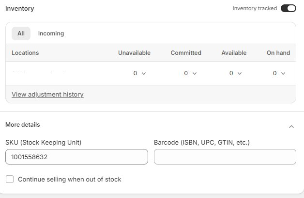
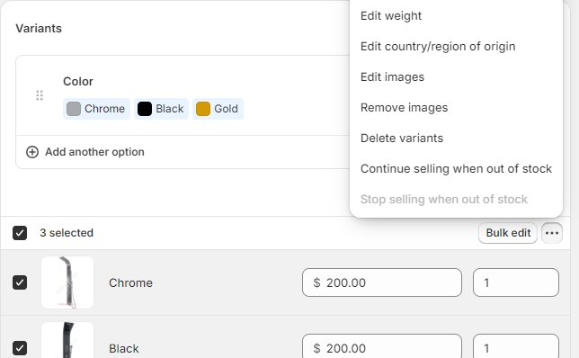
## Category vs Product type vs Collection vs Tag
每个产品 **只能有一个产品分类（product category）和一个产品类型（product type）**，多个Collection，多个tags。都是optional的
```
Category = 官方标准分类（税务/渠道）    
Product Type = 店铺产品线    
Collection = 商品列表页面    
Tag = 灵活标签
```

| 维度                     | Category        | Product Type | Collection | Tag        |
| ---------------------- | --------------- | ------------ | ---------- | ---------- |
| 本质                     | 官方标准分类          | 商家自定义单值分类    | 商品集合/列表页   | 标签         |
| 是否 Shopify 官方体系        | ✅ 是             | ❌ 否          | ❌ 否        | ❌ 否        |
| 每个产品可设置数量              | 1 个             | 1 个          | 多个         | 无限         |
| 是否可以自定义                | ❌ 只能选官方分类       | ✅ 完全自定义      | ✅ 完全自定义    | ✅ 完全自定义    |
| 是否有层级结构                | ✅ 多级层级 taxonomy | ❌ 单层         | ⚠️ 页面层级    | ❌ 无层级，扁平结构 |
| 是否用于税务计算               | ✅ 是             | ❌ 否          | ❌ 否        | ❌ 否        |
| 是否用于 Google / Facebook | ✅ 是             | ❌ 否          | ❌ 否        | ❌ 否        |
| 是否用于产品属性映射             | ✅ 是             | ❌ 否          | ❌ 否        | ❌ 否        |
| 是否创建前台页面               | ❌ 否             | ❌ 否          | ✅ 是        | ❌ 否        |
| 是否可以用于导航菜单             | ❌ 否             | ❌ 否          | ✅ 是        | ❌ 否        |
| 是否支持自动规则               | ⚠️ 少            | ✅ 可以         | ✅ 可以       | ✅ 可以       |
| 是否适合做过滤条件              | ❌ 不常用           | ⚠️ 可以        | ❌ 不适合      | ✅ 最常用      |
| 是否用于 Shopify Analytics | ⚠️ 较少           | ✅ 常见         | ⚠️ 有       | ❌ 很少       |
| 是否支持 CSV 导入            | ✅               | ✅            | ⚠️         | ✅          |
| 是否影响 SEO               | ❌               | ❌            | ✅ 强        | ⚠️ 间接      |
| 是否影响网站 URL             | ❌               | ❌            | ✅          | ❌          |
| 是否适合作为主分类              | ⚠️ 官方分类         | ⚠️ 内部主类      | ✅ 前端主类     | ❌          |
### Product category 是 shopify官方预定义的产品类别，不能改。  
主要用于：
- 确定产品应适用的 **税率**    
    - 有些产品可能有特殊税率或税收减免        
    - 当产品被正确分类时，结账时会计算出最准确的税率        
- 让产品更容易在 **需要标准化产品类型的销售渠道** 上销售，例如 Facebook 或 Google。
### Product type 是一种创建 **自定义分类** 的方式。
允许你使用 **不同于 Shopify 标准产品分类的类别**。- 主要用于 **店铺内部组织 + 自动化规则 + 报表.
Product Type 本身不能直接用于前台导航。
原因：
- Product Type **只是商品字段** 
- 它 不会自动生成页面
- 前台导航需要 **URL 页面    
而 Product Type 没有 URL，例如：
product_type = Power Tools
不会产生：
/power-tools

Product Type用在三个场景：
1 内部产品线管理
例如：
Shoes  
Hoodie  
T-Shirt  
Accessories
2 Shopify Analytics报表统计
统计产品线销售。
3 自动 Collection 规则
例如：
product_type = hoodie
自动进集合。
## Collection 的作用是 展示商品列表页，但它不是产品属性。
用途：
- 前台导航    
- 商品列表页面    
- SEO landing page    
特点：
- 可以自动或手动    
- 可以有多个    
- 偏 **网站页面**
### Tag 是标签，可以无限添加，很容易乱。
用途：
- 自动集合规则    
- 商品筛选    
- 内部管理   
特点：
- 无限数量    
- 最灵活    
- 偏 **过滤条件**
### 使用例子
很多成熟店铺会这样设计：
**Category**
```
Apparel & Accessories > Clothing
```
**Product Type**
```
Hoodie  
T-Shirt  
Jacket
```
**Collection**
```
Men  
Women  
New Arrivals  
Best Sellers
```
**Tags**
```
black  
summer  
sale  
oversized  
cotton
```
# FAQ
## 同一个产品，同样的sku，怎么区分成色，因为我收货可能有二手的
## 用 Variant 区分成色
适用于：
- 同型号    
- 但不同成色（A/B/C级）
Grade A – Excellent  
Grade B – Good  
Grade C – Fair
Grade D – For Parts / Repair
### ✅ Grade A — Excellent / Like New 60%
**Definition:**
> Item is in excellent condition with minimal signs of use. Fully functional and tested. May have very light cosmetic wear (minor scratches or marks), but overall appearance is close to new. No structural damage.
**Typical characteristics:**
- 100% fully working    
- Very minor cosmetic wear    
- No cracks or major dents    
- Clean and well maintained    
- All major components intact
    
适用情况：
- 使用极少    
- 外观接近全新    
- 功能完全正常
### ✅ Grade B — Good Condition 50%
**Definition:**
> Item is in good working condition with visible signs of regular use. Fully functional and tested. Cosmetic wear such as scratches, scuffs, or minor surface marks may be present. No impact on performance.
**Typical characteristics:**
- 100% working    
- Noticeable cosmetic wear    
- May have minor surface imperfections    
- No functional defects    

适用情况： 
- 外观有使用痕迹    
- 无功能问题
### ✅ Grade C — Fair / Heavily Used 35%
**Definition:**
> Item shows significant signs of use but remains fully functional. May have heavy cosmetic wear such as scratches, discoloration, or minor dents. Tested and operational. Cosmetic condition does not affect core functionality.
**Typical characteristics:**
- Fully operational    
- Heavy cosmetic wear    
- Possible minor non-critical defects    
- Structurally intact    
适用情况：
- 外观较旧    
- 功能使用正常
### ✅ Grade D — For Parts / Repair
> Item is not fully functional and is sold as-is for parts or repair. May have functional defects. No warranty or returns accepted.
**Typical characteristics:**
- Sold as-is    
- No warranty    
- No returns
适用情况：
- 本商品按现状出售
- 仅适用于零件或维修用途
- 不接受退货
### 🚨 重要：避免法律风险
建议在页面加一句总免责声明：
> All items are tested and verified to be in working condition unless otherwise stated. Cosmetic condition does not affect performance.
## “收旧货”业务的工作流
由于旧货每一件都是 **孤品 (Unique)**，你的工作流应该是：
1. **上架触发：** 通过 API 或后台上架，打上 `Tag: Used` 和 `Vendor: Makita`。    
2. **自动入库：** 商品自动进入 **"Used Tools"** 和 **"Makita"** 两个自动集合。    
3. **售罄处理：** 一旦卖出，库存变为 0。    
4. **自动隐藏：** 集合中的 `Inventory stock > 0` 规则生效，商品立即从前端消失，无需你手动去删集合里的产品。
如何使用tag
shopify的tag区分大小写，规范是全部小写
## 如何更改owner name
Settings > General > Business details
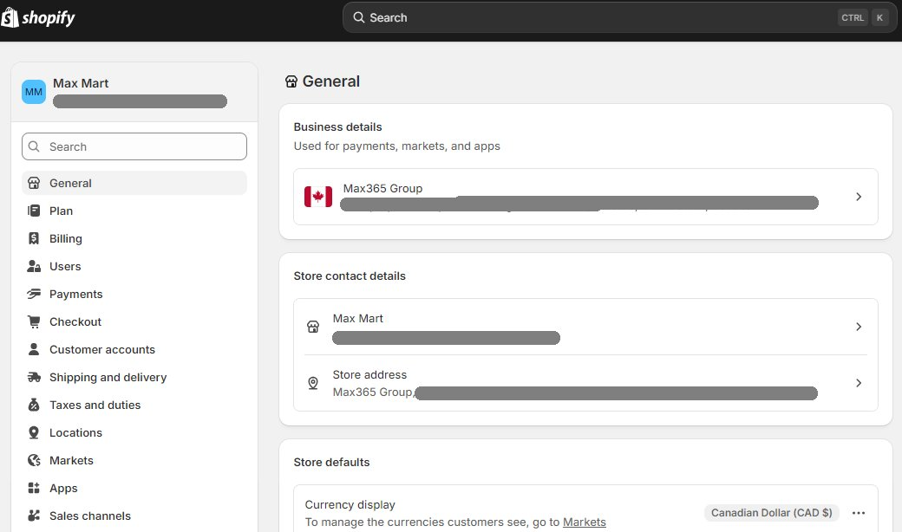
右上角 my store > email account > change name：
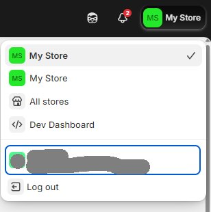
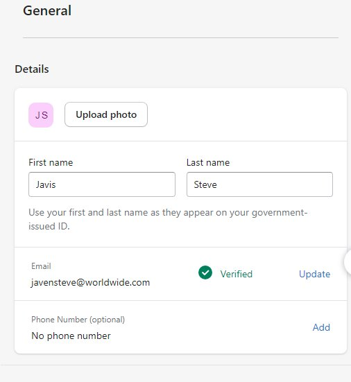
transfer store 给其他人 （可选）settings > general > 最下面 transfer store, 注意先要 deactivate payment
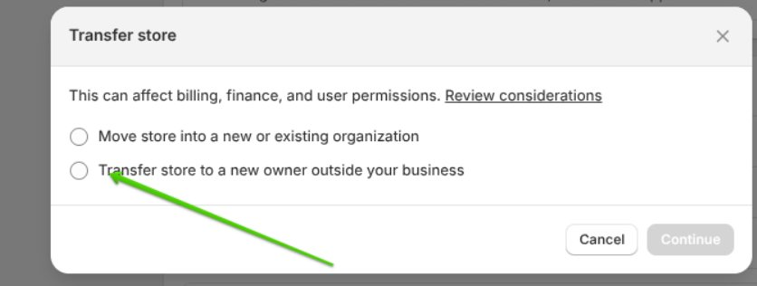
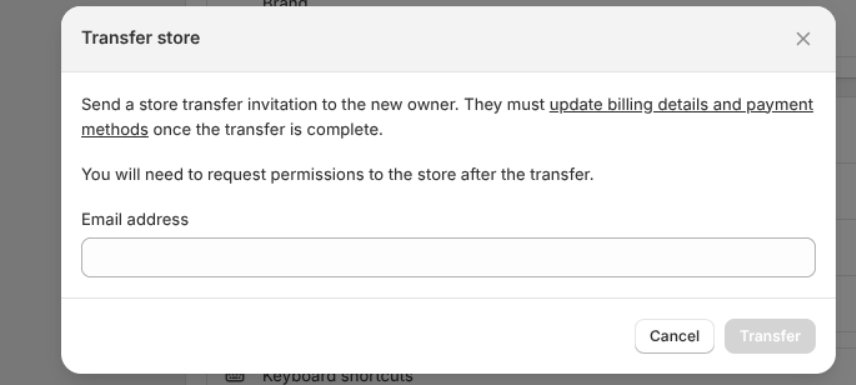
## 怎么填写税号？
配置支付 
settings > payments > 逐步填写cra资料 > 添加cra文档，个人statement，个人驾照 > 提交审核
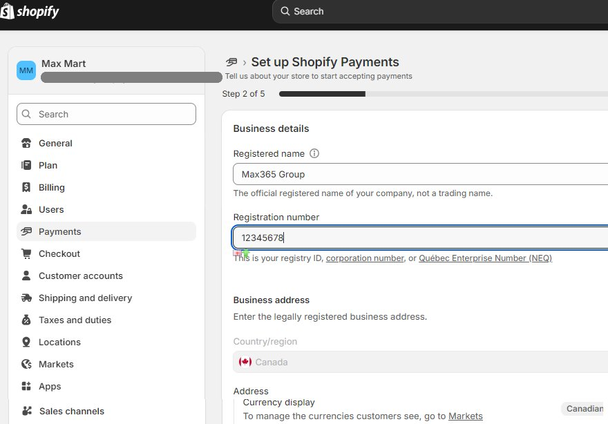
setting > taxes and duties > canada > enter hst/gst
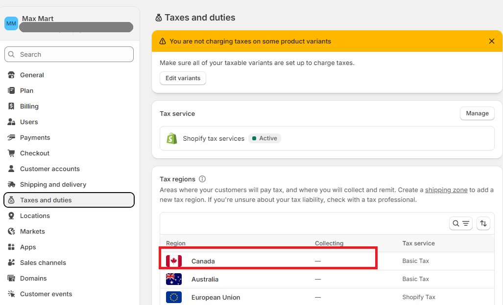
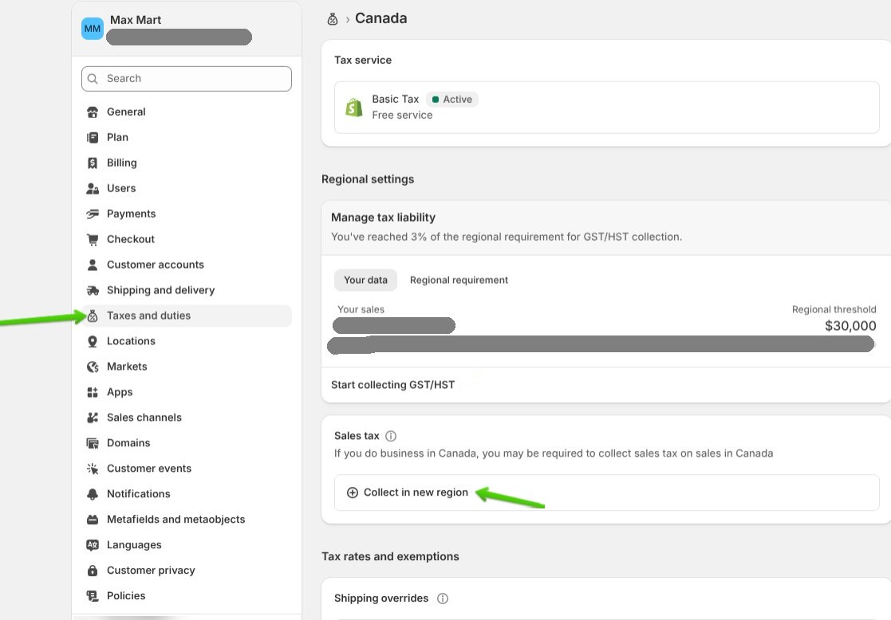
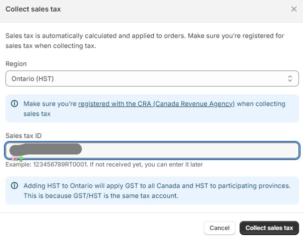
## 怎么统计 draft order？
我有若干客户想定不同的产品。
我打算创建订单，并统计卖出去的数量，注意并没有真正卖出去！
我只是想创建订单草稿，并获取这些产品订单，和每个产品预定的总数量，怎么做？
选中 > export excel > pivot table
## 怎么存档 draft order？
有的draft order，我希望关闭，不再显示，不再减库存，但是希望能通过查询或者存档的方式存在，应该怎么做？
- 打开 Draft Order    
- 点击 **Mark as paid**    
- 付款方式选择：Payment due later
- 然后立刻：Cancel order / Restock items. 这样订单会变成：Canceled , Archived
优点：
- 会自动进入 Archived    
- 不会影响库存    
- 可以随时搜索找到    
- 不在活跃订单列表
## shopify 里面，怎么给客人发一个quote
用 Draft Order（订单草稿） 来当报价单
创建 draft order
```
Shopify后台 → Orders → Drafts → Create draft order
```
- 添加客户（必须有邮箱）    
- 添加产品    
- 修改价格（如果需要特殊报价）    
- 可以加备注    
- 可以加折扣    
- 可以设运费
- 不要 Mark as paid
发送报价给客户 > Send invoice
```
Shopify 会发送一封邮件给客户，内容包含：
- 产品明细    
- 总金额    
- 一个支付链接（Checkout 页面）    

客户可以：
- 直接在线付款    
- 或忽略不付款    

只要客户没有付款，这个订单还是 Draft 状态。
客户付款 = 转为正式 Order
```
## shopify怎么创建一个产品的不同型号？
后台创建的时候，是同一个product，指定不同的型号，不同的sku，上传不同的图片，指定不同的数量。
用户可以在网页中搜索不同型号，点击后打开同一个产品详细页面。
用户在同一个产品详细页面里面切换不同型号。

使用 **Variants（多变体/多型号）**管理“同款不同规格”的标准做法。Shopify 的 Variant 适用于：
- 尺寸不同    
- 颜色不同    
- 数量/包装不同    
- 型号不同
```
products > add product > variants > add options 

设置选项：
- Option name（选项名称）：比如输入“型号”或“颜色”。    
- Option values（选项值）：输入具体的型号名称（如：型号A、型号B、型号C），每输入一个按一下回车。
  
添加完选项后，下方会出现一个变体列表。在这里你可以为每个型号进行精准配置：
- SKU/UPC：为每个型号输入唯一的 SKU（方便你统计发货）。    
- Price（价格）：不同型号可以设置不同价格。    
- Available（库存）：点击数量直接修改每个型号的现有库存。    
- 单独重量
- **图片关联（关键步）：** 1. 先在顶部的 **Media** 部分上传所有型号的图片。 2. 回到 **Variants** 列表，点击每个型号左侧的**图片图标**。 3. 选择对应的那张图片。这样用户在网页上点击“型号B”时，主图会自动跳转到型号B的照片。
```
注意，Shopify 限制
```
单个产品
最多 3 个 Options  
最多 100 个 Variants
如果你型号很多（比如 200+），要改结构。比如合并options, 拆成多个 Product
```
### variant和独立产品设置的最佳实践：
常见options：尺寸、颜色、包装
基本原则
```
Variant 用来表达“同一产品的购买选项”  
Product 用来表达“本质不同商品”
应该按客户搜索习惯来决定Product 级别，而不是按技术分类。
判断原则是，如果放在一个product里面，客户会不会因为看错颜色、容量等选项买错？如果会，就必须分成独立product
完全不同的型号，第x代，用不同product，比如2804-20, 2904-20.
根据平台特点，希望重要突出的产品，用不同的product。比如Milwaukee电池的不同容量，在hardware网站就分不同product；但在Walmart网站就用variant。
变体名称（Variant Title）在 Google 搜索结果中的权重远低于产品标题。如果某个技术参数特别重要，是客户的搜索关键词，比如"18V Brushless",务必将这个参数放入Product Title（标题）中。
技术参数放在描述、metafield里面:转速、功率、材质说明、认证
```
不同直径 = 不同 Product
```
7-1/4" 锯片
10" 锯片
12" 锯片
```
影响“兼容性”“功能性”的 = 独立 Product
```
电压
接口类型 (110v vs 220v)
尺寸规格
不同平台系统 (windows系统 vs Mac系统)
物理接口不兼容 = 绝对的独立产品。
不同Gauge的电线
不同灯座的灯具
```
不同外观形状/材质 = 独立Product
```
m12 电池不同容量有不同形状
锯片材质的高碳钢/双金属/钛合金/碳素钢
```

影响“价格层级”/套装/包装数量的 = Variant
```
套装
数量
容量

分析：在 Variant 里设置：1只装 ($5), 5只装 ($20), 10只装 ($35)。这种在同一页面切换时的价格冲击力，比分成三个产品要强得多。
```

适合做Options:
```
长度
颜色
包装数量, Packaging
	Single (1-Pack)
	Box (10-Pack)
	Case (20 Boxes)
```

具体例子：
工具
```
套装电池数量
```
螺丝
```
长度(Length)
包装数量(Package Quantity)
```
灯具
```
颜色
套装
```
开关
```
颜色
```
圆锯片：
```
齿数(Number of Teeth)
包装(Number of Pieces in Set) 单片装, 3片优惠装

但尺寸(Blade Diameter inch)创建不同product
```
大力锯片
```
长度  
包装

如果不同材质代表不同的使用寿命，必须分不同product
```
电线variant
```
长度

不同gauge必须分不同product
如果不同电线颜色代表不同的含义，就分不同product
如果是装修线（如 Romex），白色、黑色、红色代表不同的功能线，必须分成独立产品，方便客户分别加入购物车并review。
```
热缩管，电工胶带，水工胶带
```
颜色。如果不同颜色代表不同黏性和不同使用场景，跟功能有关，就分product。
```
## 什么时候应该做成两个独立 Product？
只有在这些情况下：
❌ 价格差异非常大（例如单个 $10，整箱 $300）
❌ 目标客户群不同（零售 vs 批发）
❌ 想单独做广告投放
❌ 页面内容需要完全不同描述
否则不建议分开。

|情况|建议|
|---|---|
|内容相同，只是数量不同|Variant|
|产品本质不同|独立 Product|
|定位不同市场|独立 Product|
## 进阶建议（避免库存混乱）
如果你确实遇到了极其复杂的产品（比如一个开关有 5 种颜色、4 种面板材质、3 种智能协议），导致超过 100 个变体：
- **技巧 A：利用“链接产品”（Linked Products）** 在描述区或使用主题代码，将不同颜色的同款产品相互链接。用户点击色块，实际上是跳转到了另一个产品页面，但在视觉上感觉是在切换型号。    
- **技巧 B：使用“附件”逻辑（Add-ons）** 如果变体多是因为“带不带电池/带不带钻头”，不要在变体里穷举。创建一个“裸机”变体，然后在下方使用 **"Frequently Bought Together"（常买组合）** 引导用户勾选电池。这不仅解决了变体限制，还能显著提高客单价（AOV）。
- 如果你卖：
	- 单个装    
	- 3个装    
	但实际仓库是“单个库存”
	比如：
	库存 100 个单品  
	如果卖 1 个 3个装 → 应该减少 3 个单品库存
	Shopify 默认不会自动关联库存。
	如果你有这种需求，需要：
	- Bundles App    
	- 或库存联动 App    
	否则 3个装和单个装库存是独立的。
## 同一个产品，购买不同数量有不同折扣，或者buy x get y，如何实现？
### 用 Quantity Break / Volume Discount
核心思路
👉 不创建多个 Variant ，不增加sku
👉 只有一个产品  
👉 根据购买数量自动打折
客户思维是：
> 我要买这个产品，多买便宜
而不是：
> 我要买 5个装这个型号
实现方法：
1. 用 Shopify Discount 功能：
Discount → Automatic discount
设置：
- Minimum quantity = 5    
- 折扣百分比   
⚠ 但默认后台不显示阶梯表，需要主题支持。
1. 安装 Volume Discount App：
- 自动阶梯价显示    
- 页面直接展示：
```
Buy 5+ save 10%
Buy 10+ save 20%
```
对 hardware 零售非常好用（特别是螺丝、耗材、电料）。

volume discountapp，支持产品页直接显示数量折扣和自动优惠, 显示数量阶梯说明信息
Revy Upsell & Cross Sell (有免费版本) **免费版限制：** 通常限制每月通过插件产生的订单数量（如每月前 50 笔订单免费）。
Hextom: Ultimate Sales Boost (功能最全的免费版),Shopify 插件大厂，支持在产品页显示“Buy X Get Y”的标签或简单的数量折扣提醒。$9.99/m
https://apps.shopify.com/ultimate-sales-boost 免费版仅对Starter，Basic plan $9.99/m
Snap Bundles Volume Discounts, 每月500刀免费
Pumper Bundles Quantity Breaks，每月300刀免费
Rapi Bundles Builder & Upsells，100刀免费
Bundler ‑ Product Bundle $9.9/m
DE Volume Discount Bundle Apps, 每月50单免费，https://apps.shopify.com/volume-discounts-dealeasy，$8.99每月500单
AOV.ai Bundles Upsell https://apps.shopify.com/aov-bundle-upsell
Vitals https://apps.shopify.com/vitals 仅对测试网站免费，$29.99/m
Simple Bundles & Kits https://apps.shopify.com/simple-bundles 免费限3个bundle，$24/m
Shopacado ‑ Volume Discounts. $7.99/m, https://apps.shopify.com/custom-pricing-discounts-by-appikon
Bundler – Product Bundles, 免费仅是试用，https://apps.shopify.com/bundler-product-bundles $9.99/m
Discount Mixer: Bulk Discounts https://apps.shopify.com/discount-mix 免费版- Up to 3 campaigns，300 live discount variants

## 用 Variant 做“1个装 / 5个装 / 10个装”
什么时候适合用这个？
- 你是卖“预包装套装”    
- 仓库真的是 5个一包 ，供货商/厂家出厂就是打包好的
- SKU 不同    
- 供应商本身就是这样卖
缺点
- SKU 数量增加    
- 客户可能误选    
- Variant 占用数量限制
- SEO 不增加权重
## 如何实现套装
Shopify Bundles（官方）
这是 Shopify 官方在 2023 年推出的原生插件。它不是传统的“满减”插件，而是通过创建“组合产品”来实现多买优惠。
## 如何打印draft order，quote？
shopify order print. 功能弱，不支持draft order

Order Printer Pro: PDF Invoice
[Order Printer Pro: PDF Invoice](https://apps.shopify.com/print-now)
free: 50pcs/m; $10: 51 to 500 orders / month;
```
<!-- Document Settings -->
{% assign SETTING_date_format = "%Y-%m-%d" %}

<!-- 隐藏tax列 -->


<!-- Shop info -->

 



<!-- shop name -->
          
            {{ shop_name_text }}
          
            {{ shop.name }}
          

<!-- hide tax column -->
      
        <div class="order-table-cell item-tax text-align-right subtitle-bold to-uppercase">
          {{ TEXT_tax }}
        </div>
      

                
                  <div class="order-table-cell item-tax text-align-right">
                    
                      {{ tax.price | divided_by: line_item.quantity | money }}
                    
                       {{ 0.0 | money }}
                    
                  </div>
                

<!-- shop url -->
      <a href="https://{{ shop_url }}" target="_blank">{{ shop_url }}</a>

<!-- format address -->      
        <p class="address-detail">
          
            {{ shipping_address | format_address }}
            
              <br>
              {{ TEXT_tel }} {{ shipping_address.phone }}
            
          
          
	        <div>
	           显示公司名优先，否则显示姓名 
	          
	            <strong>{{ shipping_address.company | default: shipping_address.name }}</strong><br>
	          
	
	           街道地址1和2，只有存在才显示 
	          
	            {{ shipping_address.address1 }}<br>
	            {{ shipping_address.address2 }}<br>
	          
	
	           优雅组合城市、省、邮编，避免多余逗号和空格 
	          
	          
	          
	            
	            
	          
	          
	            
	            
	          
	          {{ city_province_zip }}<br>
	
	           国家，如果存在 
	          {{ shipping_address.country }}<br>
	
	           电话，如果存在 
	          
	            {{ TEXT_tel }} {{ shipping_address.phone }}
	          
	        </div>
        </p>

```
shopify的官方email通知不能直接插入附件，可以插入链接 
先获取附件链接 > 修改 Settings > notifications > 合适位置插入链接
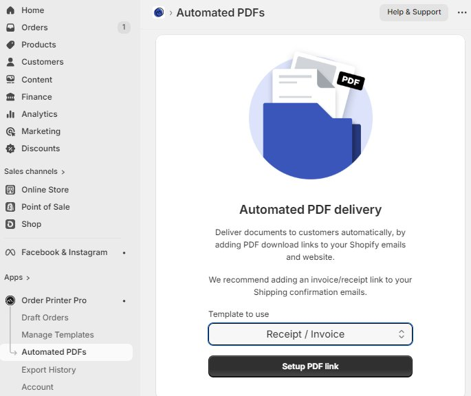
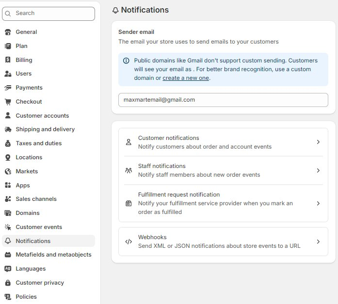
Printly ‑ Invoice Print
https://apps.shopify.com/print-now 
free: 30pcs/m, 
Vify Order Printer
https://apps.shopify.com/vify-order-printer
free: 50pcs/m; $10.99/m
Simple Invoice ‑ Order Printer
https://apps.shopify.com/simplio-simple-invoice
free: 50pcs/m; $9.99/m
## shopify 怎么管理vendor 和 brand?
在 Shopify 中，Vendor（供应商） 和 Brand（品牌） 共享同一个系统字段。虽然 Shopify 后台只有一个叫 Vendor 的位置，但你可以灵活地根据业务需求来定义它。
统一用大写开头

| 情况          | 正确做法                                          |
| ----------- | --------------------------------------------- |
| 你是经销商       | Vendor = 供应商                                  |
| 你是品牌方       | Vendor = 原料供应商/工厂名<br>方便内部追踪货源，前台隐藏这个字段不给客户看。 |
| 你是零售商，卖多个品牌 | Vendor = Brand<br>前台客户可以看到品牌，后台你可以按品牌筛选。      |

Products → 勾选多个产品 → Bulk edit → 添加 Vendor 列 → 批量改

默认情况下，很多主题（如 Dawn）会自动显示 Vendor。
- **如果你想显示品牌**：进入 **Online Store > Themes > Customize**。在产品页面设置中，勾选 **Show vendor**。    
- **如果你想隐藏（自研品牌常用）**：在同样位置取消勾选 **Show vendor**，避免暴露你的供应商名称。
## 怎么添加自定义元数据？
Settings → Metafields → Products
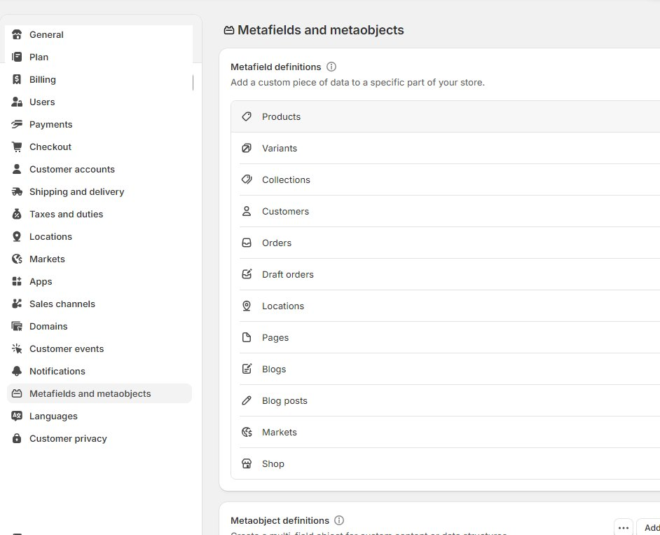
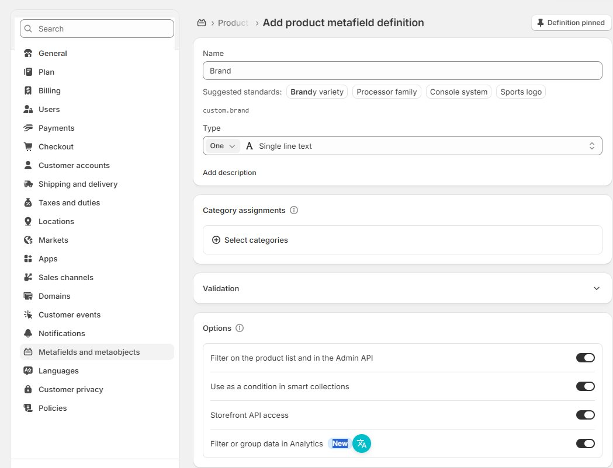
metaobject 相当于自定义表格
Metaobject 应用：
- Brand Metaobject    
- FAQ Metaobject    
- Size Guide Metaobject
然后在产品页插入Dynamic Block
## How to change from order draft to order?
在 **Shopify** 里，**Draft Order → 正式 Order** 本质只有一个原则： 
```
完成 draft（complete）并进入订单系统。
```
这个过程通常是 **付款或标记付款时自动转换**。
4种标准方法：

| **特性**    | **发送账单 (Send Invoice)** | **标记为已付款 (Mark as Paid)** | Collect by Credit Card |
| --------- | ----------------------- | ------------------------- | ---------------------- |
| **适用场景**  | 远程收款、批发业务               | 线下收款、赠品、手动入账              | 远程收款                   |
| **支付手续费** | **有**（按正常交易费率）          | **无**（因为没过网关）             | **有**（按正常交易费率）         |
| **库存扣除**  | 支付成功后扣除                 | 订单生成后扣除                   | 支付成功后扣除                |
| **自动化**   | 客户自主完成                  | 需手动确认                     | 需手动确认                  |
1. Send Invoice → 客户付款（最常见）客户会收到一封包含付款链接的邮件。客户点击链接，在你的网站前端完成结账（Checkout）。支付成功后，草拟订单会自动转为正式订单。
```
Create Draft Order
        ↓
Send Invoice
        ↓
Customer Checkout
        ↓ automatically
Order Created & Draft Order Completed
        ↓  
Pick items  
        ↓  
Pack items  
        ↓  
Fulfill order  
        ↓  
Send tracking / pickup in store
        ↓ automatically 
Order Archived
```
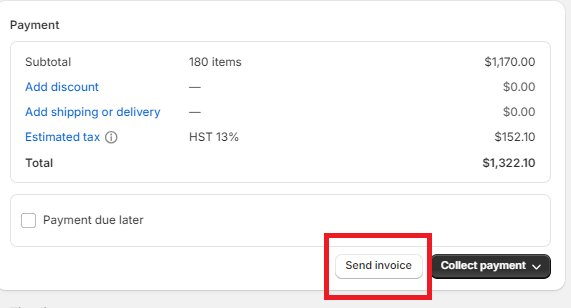
```
流程：
1. 打开 **Draft Order**    
2. 点击 **Send Invoice**    
3. 客户收到邮件    
4. 点击 checkout link    
5. 完成付款    
6. Draft → 自动变成 **Order**    

特点：
- 自动进入订单系统    
- 自动付款记录    
- 自动触发 Shopify flow / webhook    

适合：
- B2C    
- B2B invoice    
- email订单    

这是 Shopify 官方最推荐方式
```
2. Collect Payment（线下收款/外部支付）如果你已经通过线下方式（如银行转账、现金或微信/支付宝私下转账）收到了款项，这是最快的方法。
> 注意shopify payments会收取费用
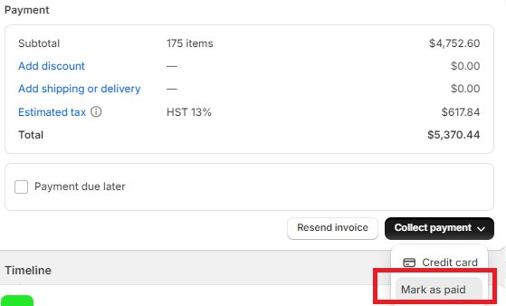
```
流程：
1. 打开 Draft Order    
2. 点击 **Collect Payment**    
3. 选择支付方式    
    - Credit card        
    - mark as paid (pos, cash)    
4. 收款完成
   
适合：
- 电话订单    
- 微信订单
- POS    
- 客服代下单  
- Bank transfer    
- PayPal outside    
- Wire transfer    
- Stripe outside 
- etransfer
```

3. Collect Payment > Credit Card > 手动输入信用卡
如果你正通过电话与客户沟通，且拥有对方的支付卡信息。
- **操作：** 点击 **Pay with credit card**，手动输入卡号等信息。    
- **结果：** 系统通过你后台配置的支付网关（如 Shopify Payments）扣款，扣款成功后自动转为正式订单。
> 注意shopify payments会收取费用

4. API 完成 Draft（开发者用, 自动化）
如果你是用 App / ERP / automation 创建 draft。
使用 API / GraphQL mutation：
```
draftOrderComplete
```

# Reference
https://www.shopify.com/ca/pricing