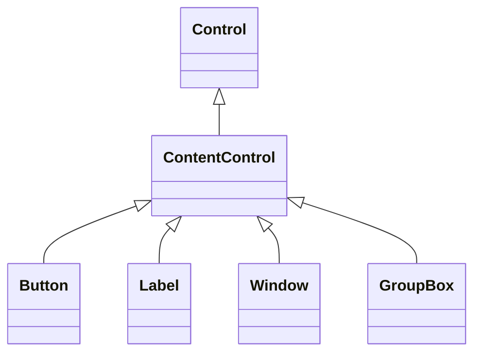
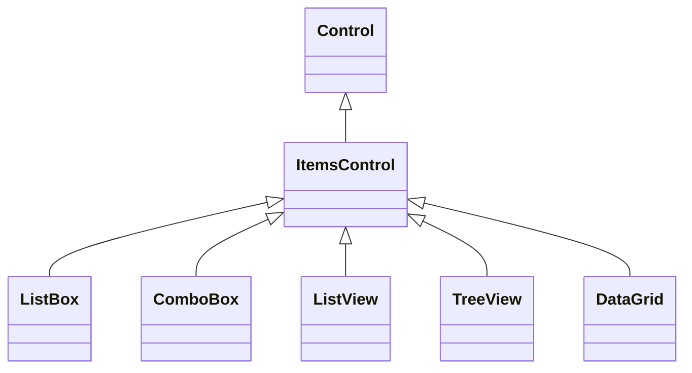

# Introduction
# WPF UI控件继承图
## 控件继承结构
DependencyObject 是 WPF 所有“能参与依赖属性系统”的基类。
只要一个类要使用 `DependencyProperty`，就必须继承它。
实现了DependencyObject，一个控件就可以使用 Binding、Style、Animation、Default Values。
DependencyProperty代表控件属性，是wpf中实现数据绑定的基础。
```
DispatcherObject
└─ DependencyObject
	├─ Freezable                                ← Brush、Transform、Animation 等
	│
	└─ Visual
	    └─ UIElement
	        └─ FrameworkElement
	            ├─ Control (有 Style、ControlTemplate、Template、Focus、Triggers等)
	            │   │
	            │   ├─ ContentControl (单个数据项，有Content, ContentTemplate, ContentTemplateSelector) 
	            │   │   ├─ Button
	            │   │   ├─ CheckBox
	            │   │   ├─ RadioButton
	            │   │   ├─ Label
	            │   │   └─ ComboBoxItem
	            │   │
	            │   ├─ HeaderedContentControl  ← 有 Header 和 HeaderTemplate
	            │   │   └─ GroupBox
	            │   │
	            │   ├─ ItemsControl (多个数据项，有Items、ItemsSource、ItemTemplate) 
	            │   │   ├─ ListBox
	            │   │   │   └─ ListBoxItem     ← 每一行的“容器”（Container）
	            │   │   ├─ ComboBox
	            │   │   ├─ TreeView
	            │   │   ├─ Menu
	            │   │   └─ TabControl
	            │   │
	            │   └─ TextBoxBase
	            │       ├─ TextBox
	            │       └─ RichTextBox
	            │
	            └─ Panel                        ← 负责布局（Layout）
	            │   ├─ Grid
	            │   ├─ StackPanel
	            │   ├─ DockPanel
	            │   ├─ WrapPanel
	            │   └─ Canvas
	            │
	            └─ ContentPresenter（负责显示控件的 Content）           
```
## template继承图
```
DispatcherObject
├─ ContentPresenter (用于显示 ContentControl 的 Content)
│
└─ FrameworkTemplate (所有模板的抽象基类)
     ├─ ControlTemplate (控件外观模板)
     ├─ DataTemplate ← 内容模板 
	 │        = ContentControl.ContentTemplate 属性
     │     └─ HierarchicalDataTemplate ← TreeView 等层级数据模板
     │           
     └─ ItemsPanelTemplate ← ItemsControl 的 Panel 模板

────────────────────────────────────────────
# 选择器体系（不属于 UI 树，不属于 Template 树，是独立的）
DataTemplateSelector  ← 选择DataTemplate的基类
	= ContentControl.ContentTemplateSelector 属性

# 内部模板内容树（不是公共类型，不在 UI 树中）
TemplateContent (internal)  ← 用于 XAML Loader
```
# 常见UI控件
## ContentControl
ContentControl 是 WPF 中一个基础且强大的控件，是 WPF 内容模型的核心组件，它是许多常用控件的基类。
ContentControl就是一个用来装内容的容器，它只有一个作用： 👉 **显示一段“内容” (Content)**
这个内容可以是：
- 文本    
- Button    
- StackPanel    
- UserControl    
- 任何 UI    
- 甚至 DataTemplate 生成的 UI
```xml
<ContentControl Content="Hello World!" />
```
ContentControl 是一个只能包含**单个子元素**的控件，其核心特点是：
- 通过 `Content` 属性承载内容    
- 提供内容呈现模板（`ContentTemplate`）    
- 是大多数"容器型"控件的基类

###  Content 属性
- 可以接受任何类型的对象    
- 直接显示简单类型（字符串、数字等）    
- 通过模板显示复杂对象
```xml
<!-- 字符串内容 -->
<ContentControl Content="简单文本"/>

<!-- 复杂对象 -->
<ContentControl>
    <ContentControl.Content>
        <StackPanel>
            <TextBlock Text="多行"/>
            <TextBlock Text="内容"/>
        </StackPanel>
    </ContentControl.Content>
</ContentControl>
```
- 动态内容切换: ContentControl 最强的作用：绑定一个对象，它会显示“对应的 UI”
```xml
<ContentControl Content="{Binding CurrentView}"/>
```
如果你给 ContentControl 一个对象，它会根据这个对象的类型，去寻找对应的 DataTemplate 来创建 UI。
### 内容模板系统
- `ContentTemplate`：定义如何呈现内容    
- `ContentTemplateSelector`：动态选择模板    
- `ContentStringFormat`：格式化文本显示
```xml
<ContentControl Content="{Binding CurrentDate}">
    <ContentControl.ContentTemplate>
        <DataTemplate>
            <StackPanel>
                <TextBlock Text="{Binding Day}"/>
                <TextBlock Text="{Binding Month}"/>
            </StackPanel>
        </DataTemplate>
    </ContentControl.ContentTemplate>
</ContentControl>
```
配合 DataTemplate 实现动态界面
```xml
<Window.Resources>
    <DataTemplate DataType="{x:Type vm:LoginViewModel}">
        <views:LoginView/>
    </DataTemplate>
    <DataTemplate DataType="{x:Type vm:MainViewModel}">
        <views:MainView/>
    </DataTemplate>
</Window.Resources>
```
### 基于ContentControl的派生控件
几乎所有包含"内容区域"的控件都继承自 ContentControl：

| 控件         | 特殊功能  | 典型用法                                                            |
| ---------- | ----- | --------------------------------------------------------------- |
| `Button`   | 点击事件  | `<Button Content="确定"/>`                                        |
| `Label`    | 助记键支持 | `<Label Target="{Binding ElementName=textBox}">_Name</Label>`   |
| `Window`   | 顶级容器  | `<Window><Grid>...</Grid></Window>`                             |
| `GroupBox` | 分组边框  | `<GroupBox Header="选项"><StackPanel>...</StackPanel></GroupBox>` |
| `TabItem`  | 选项卡项  | `<TabItem Header="页签"><Content>...</Content></TabItem>`         |
|            |       |                                                                 |
## ItemsControl
与 ContentControl是兄弟关系，都继承自 Control。
ItemsControl 是 WPF 中用于显示**项目集合**的基础控件，专门用于显示**多个数据项**，它是所有列表型控件的基类。其核心特点是：

- 通过 `Items` 或 `ItemsSource` 属性绑定集合数据    
- 使用 `ItemTemplate` 定义每个项的呈现方式    
- 是 WPF 数据绑定和集合展示的基础设施


### 数据绑定方式
```xml
<!-- 直接添加项 -->
<ItemsControl>
    <sys:String>项目1</sys:String>
    <sys:String>项目2</sys:String>
</ItemsControl>

<!-- 通过ItemsSource绑定 -->
<ItemsControl ItemsSource="{Binding MyItems}"/>
```
### 元素呈现方式
- `ItemTemplate`：定义每个数据项的视觉呈现    
- `ItemContainerStyle`：项容器的样式    
- `ItemsPanel`：控制项目布局的面板
```xml
<ItemsControl ItemsSource="{Binding Employees}">
    <ItemsControl.ItemTemplate>
        <DataTemplate>
            <StackPanel>
                <TextBlock Text="{Binding Name}"/>
                <TextBlock Text="{Binding Department}"/>
            </StackPanel>
        </DataTemplate>
    </ItemsControl.ItemTemplate>
    <ItemsControl.ItemsPanel>
        <ItemsPanelTemplate>
            <WrapPanel/> <!-- 改为流式布局 -->
        </ItemsPanelTemplate>
    </ItemsControl.ItemsPanel>
</ItemsControl>
```
### 派生控件
大多数集合展示控件都继承自 ItemsControl：

|控件|特殊功能|典型用法|
|---|---|---|
|`ListBox`|选择功能|`<ListBox ItemsSource="{Binding Items}"/>`|
|`ComboBox`|下拉选择|`<ComboBox ItemsSource="{Binding Options}"/>`|
|`ListView`|多列视图|`<ListView View="{GridView}">...</ListView>`|
|`TreeView`|层级结构|`<TreeView ItemsSource="{Binding Nodes}"/>`|
|`DataGrid`|表格展示|`<DataGrid ItemsSource="{Binding Data}"/>`|
## 内容控件对比

|特性|ContentControl|ItemsControl|Panel|
|---|---|---|---|
|内容数量|单个|多个|多个|
|内容类型|任意对象|集合项|UI元素|
|典型用途|按钮、标签等|列表、菜单|布局容器|
|数据绑定|直接绑定Content|绑定ItemsSource|一般不直接绑定|
# Resource
Resource 在 XAML 中用 Key 命名、可被复用的对象，这些对象可以在应用程序的不同部分引用。
Resource 允许您在一个中心位置定义对象，然后在应用程序的多个地方重用它们。
它的作用是：
- 避免重复定义（复用同一个对象/样式/模板）    
- 统一管理界面元素、样式、动画、数据    
- 支持动态/静态切换，提高 UI 灵活性

定义一个简单resource
```xml
<UserControl.Resources>
    <SolidColorBrush x:Key="PrimaryBrush" Color="#107C10"/>
</UserControl.Resources>
```
使用
```xml
<Button Background="{StaticResource PrimaryBrush}"/>
```
## Resource的类型 
这些对象可以各种类型的对象：

- 样式（Style） : 用于定义控件的视觉外观和行为。    
```xml
<Style x:Key="DeleteButtonStyle" TargetType="Button">
    <Setter Property="Background" Value="Red"/>
</Style>
```

- 模板（ControlTemplate / DataTemplate）: 用于完全自定义控件的渲染方式或数据的呈现方式。 
控件模版（ControlTemplate）完全重写控件外观
```xml
<ControlTemplate x:Key="RoundButtonTemplate" TargetType="Button">
    <Border CornerRadius="6">
        <ContentPresenter/>
    </Border>
</ControlTemplate>
```
数据模版（DataTemplate）
```xml
<DataTemplate DataType="{x:Type vm:DialogueLineViewModel}">
    <le:DialogueLineEditView/>
</DataTemplate>
```

- 转换器（Converter）
转换器（IValueConverter）
```xml
<conv:IndexToOneBasedConverter x:Key="IndexToOneBasedConverter"/>
```

- 画刷(Brush)、颜色、字体: 如 `SolidColorBrush`、`LinearGradientBrush` 等，用于设置颜色、背景。
```xml
<Color x:Key="DangerColor">#D83C3C</Color>
<SolidColorBrush x:Key="DangerBrush"
                 Color="{StaticResource DangerColor}"/>
```

- 任意 CLR 对象（ViewModel、Selector、Behavior、字符串、类实例等…）
```xml
<utilSelector:LineEditTemplateSelector
    x:Key="LineEditTemplateSelector"
    DialogueTemplate="{StaticResource DialogueTemplate}" />
```

## Resource的作用域
资源**不是全局自动可见的**，它有明确作用域。

| 示例                        | 作用域                   | 解释                                    | 定义位置           |
| ------------------------- | --------------------- | ------------------------------------- | -------------- |
| `<Button.Resources>`      | 元素级(当前控件)             | 仅当前元素及子元素可访问                          |                |
| `<UserControl.Resources>` | **页面级 / UserControl** | 当前 UserControl 内所有子元素可访问              | 控件的 XAML 标签内   |
| `<Window.Resources>`      | **窗口级**               | 当前窗口内所有子元素可访问                         | 窗口的 XAML 文件    |
| `<Application.Resources>` | **应用级**               | 整个应用可访问，跨 Window / Page / UserControl | `App.xaml` 文件中 |
### 当前控件.Resources (Element-Level Resources)：
将资源字典定义在特定的控件或容器内，作用域仅限于该元素及其所有子元素。
```xml
<Grid>
    <Grid.Resources>
        <SolidColorBrush x:Key="MyButtonBackground" Color="LightBlue"/>
        <Style x:Key="GridTextStyle" TargetType="TextBlock"> <Setter Property="FontSize" Value="20"/> </Style>
    </Grid.Resources>

    <Button Background="{StaticResource MyButtonBackground}" Content="局部按钮"/>
</Grid>
```
### UserControl.Resources
### 页面级资源 (Page-Level Resources)
将资源字典定义在 `Window` 或 `Page` 对象的 `Resources` 属性中，作用域仅限于该页面/窗口。
```xml
<Window x:Class="..."
        xmlns="http://schemas.microsoft.com/winfx/2006/xaml/presentation"
        xmlns:x="http://schemas.microsoft.com/winfx/2006/xaml">
    <Window.Resources>
    </Window.Resources>
    
</Window>
```
### 应用程序级资源 (Application-Level Resources)
`<Application.Resources>` 是用于定义应用程序级资源（Application-Level Resources）的 XAML 标记。这些资源可以在整个应用程序的所有窗口、页面和控件中共享和访问。
将资源字典定义在 `App.xaml` 文件中，作用域是整个应用程序。

**定义全局样式**
```xml
<Application.Resources>
    <!-- 定义全局按钮样式 -->
    <Style TargetType="Button" x:Key="GlobalButtonStyle">
        <Setter Property="Background" Value="LightBlue"/>
        <Setter Property="FontSize" Value="14"/>
    </Style>
</Application.Resources>
```
**使用方式**：在任意窗口或页面中引用：
```xml
<Button Style="{StaticResource GlobalButtonStyle}" Content="Click"/>
```

**定义全局数据模板**
```xml
<Application.Resources>
    <!-- 定义如何显示 Person 对象 -->
    <DataTemplate DataType="{x:Type local:Person}">
        <StackPanel Orientation="Horizontal">
            <TextBlock Text="{Binding Name}" FontWeight="Bold"/>
            <TextBlock Text="{Binding Age}" Margin="10,0"/>
        </StackPanel>
    </DataTemplate>
</Application.Resources>
```
**效果**：所有用到 `Person` 类的地方（如 `ListBox`）会自动应用此模板。

**定义颜色或画笔资源**
```xml
<Application.Resources>
    <!-- 定义全局颜色 -->
    <SolidColorBrush x:Key="PrimaryColor" Color="#FF2A5CAA"/>
</Application.Resources>
```
**使用方式**：
```xml
<Border Background="{StaticResource PrimaryColor}"/>
```

### WPF 查找资源的优先级顺序：
1. 控件自身的资源 （如 `UserControl.Resources`）
2. 父容器的资源 （父容器的 `UserControl.Resources`）
3. 窗口/页面的资源（如 `Window.Resources`）    
4. 应用程序资源（`Application.Resources`）    
5. 主题资源（Theme）
> 例如：ListBoxItem 里找 Brush → 先找 ListBoxItem.Resources → ListBox.Resources → Window.Resources → App.Resources → 系统

⚠️ **但注意：**
> 子 UserControl 的 XAML **不能在编译期解析父 View 的资源**，也就是说，子view不知道怎么找父view的资源，可以通过 Resource dictionary + StatieResource 解决。

## Resource 的两种主要引用方式
StaticResource，最常用
- 编译时解析    
- 适合固定资源、不随数据变化
- 在 **XAML 加载时** 只查找并赋值一次。    
- **使用场景**: 资源内容在应用程序运行期间不会更改时（绝大多数情况）。    
- **性能/限制**: 性能更高，但如果资源被修改，引用它的属性**不会自动更新**。需要重启程序才会更新。
```xml
<Button Background="{StaticResource MyButtonBackground}" Content="静态引用"/>
```
DynamicResource，通常只用于主题切换
- 运行时解析.  支持资源动态替换（如主题切换）
- 资源可能在运行时被修改（例如，实现主题切换）。    
- 资源是**系统资源**（如 `SystemColors`、`SystemFonts`）。    
- 资源定义在应用程序树上比使用它的元素更靠下的位置。
- **性能/限制**: 由于需要在运行时创建表达式来监听变化，性能略低于 `StaticResource`
```xml
<Button Background="{DynamicResource PrimaryColor}" Content="动态引用"/>
```
✅ 一般控件样式、颜色、模板等常用 StaticResource；
✅ 需要动态切换（比如主题色）用 DynamicResource。
## 资源字典Resource Dictionary
资源字典是 一个**专门用来存放资源的 XAML 文件**
```xml
<ResourceDictionary
    xmlns="http://schemas.microsoft.com/winfx/2006/xaml/presentation"
    xmlns:x="http://schemas.microsoft.com/winfx/2006/xaml">

    <Style x:Key="DeleteButtonStyle" TargetType="Button"/>
    <conv:IndexToOneBasedConverter x:Key="IndexToOneBasedConverter"/>

</ResourceDictionary>
```
将资源定义在单独的 XAML 文件（例如 `Themes/Colors.xaml`）中，然后在需要使用的地方**合并**进来。能提高代码的组织性、模块化和可维护性（例如，用于主题切换和本地化）。
- **特点**: 推荐用于组织大量资源，实现主题切换和模块化。
- 项目大时资源集中管理，便于维护，支持多主题切换。
- 作用域是被合并的地方
### 先定义资源字典。右键文件夹 > 新建资源字典

```xml
<ResourceDictionary
    xmlns="http://schemas.microsoft.com/winfx/2006/xaml/presentation"
    xmlns:x="http://schemas.microsoft.com/winfx/2006/xaml"
    xmlns:le="clr-namespace:WinWpf.Views.Stories.LineEditors">
    <!-- 直接写代码，不需要作用域 -->
    <DataTemplate x:Key="DialogueTemplate">
	    <le:DialogueLineEditView/>
	</DataTemplate>
	<Style x:Key="DeleteButtonStyle" TargetType="Button">
	    <Setter Property="Background" Value="Red"/>
	</Style>
</ResourceDictionary>
```
### 某个页面需要的时候，再合并字典到当前页面（MergedDictionaries）

合并到 App.xaml（全局可用）
```xml
<Application.Resources>
    <ResourceDictionary>
        <ResourceDictionary.MergedDictionaries>
            <ResourceDictionary Source="/Resources/Converters.xaml"/>
            <ResourceDictionary Source="Styles/ButtonStyles.xaml"/>
            <ResourceDictionary Source="Styles/DataTemplates.xaml"/>
        </ResourceDictionary.MergedDictionaries>
    </ResourceDictionary>
</Application.Resources>
```

合并到某个 View（模块级）
```xml
<UserControl.Resources>
    <ResourceDictionary>
        <ResourceDictionary.MergedDictionaries>
            <ResourceDictionary Source="/Views/SceneLines/Templates/DialogueLineTemplate.xaml"/>
        </ResourceDictionary.MergedDictionaries>
    </ResourceDictionary>
</UserControl.Resources>
```

代码中合并（高级 / 按需）
```csharp
Resources.MergedDictionaries.Add(
    new ResourceDictionary
    {
        Source = new Uri(
            "/Views/SceneLines/Templates/DialogueLineTemplate.xaml",
            UriKind.Relative)
    });
```

注意 MergedDictionaries 顺序很重要
后面的可以 BasedOn 前面的
如果key冲突，后加载的字典 **覆盖** 先加载的
```xml
<ResourceDictionary.MergedDictionaries>
    <ResourceDictionary Source="BaseStyles.xaml"/>
    <ResourceDictionary Source="DerivedStyles.xaml"/>
</ResourceDictionary.MergedDictionaries>
```
### 引用 ResourceDictionary 中的资源
StaticResource（最常用）
```xml
Style="{StaticResource DeleteButtonStyle}"
```
特点：
- 加载时解析    
- 编译查不到就报错    
- 性能最好

DynamicResource（运行时）
```xml
Background="{DynamicResource PrimaryBrush}"
```
特点：
- 支持运行时替换    
- 性能稍低    
- 主题切换用
- 编译不报错
## 最佳实践
1. **公共资源放 Application.Resources**（主题色、全局样式）    
2. **局部资源放 Window / UserControl**（局部控件样式、模板）    
3. 尽量用静态资源 StaticResource，除非涉及到主题动态切换才用 DynamicResource    
4. **DataTemplate / ControlTemplate / Style 分别放资源**，方便复用    
5. 避免在模板里硬编码颜色 / 字体，用资源引用，方便统一管理style    
6. **复杂资源可以拆分到 ResourceDictionary 文件**，通过 MergedDictionaries 引入

### 创建资源字典
```
Resources/
 ├── Converters/
 │   ├── CommonConverters.xaml
 │   └── StringFormatConverter.cs
 |
 ├── Styles/
 │   ├── ControlStyles.xaml <-- 存放基础控件 (Button, TextBox, ListBox) 的样式
 │   ├── LayoutStyles.xaml  <-- 存放布局容器 (Grid, StackPanel) 的通用样式
 |   └── Typography.xaml    <-- 存放字体、文本相关的样式
 |
 ├── Templates/
 |   ├── ControlTemplates.xaml <-- 存放自定义的 ControlTemplate 
 |   └── DataTemplates.xaml    <-- 存放用于数据显示的 DataTemplate
 |
 ├── Themes/
 │   ├── LightTheme.xaml <-- 存放浅色主题的 Brushes 和 Colors
 │   └── DarkTheme.xaml  <-- 存放深色主题的 Brushes 和 Colors (用于主题切换)
```
合理拆分 `ResourceDictionary` **对页面加载性能影响极小** 
- ResourceDictionary **只在首次加载时解析一次**    
- WPF 会缓存已加载的字典- 
- Converter / Style 本身是轻量对象    

真正影响性能的是：
- 巨大的 DataTemplate        
- 复杂 ControlTemplate        
- 很多 DynamicResource
- 大量触发器 + 绑定
- 每个页面重复合并同一个字典

Converter 全局可放，DataTemplate / View 相关资源不要
“基础 Converter” 全局化，定义 /Resources/Converters.xaml
✔ 与具体 View 无关  
✔ 通用、稳定  
✔ 小、无状态

然后全局使用：
```xml
<Application.Resources>
    <ResourceDictionary>
        <ResourceDictionary.MergedDictionaries>
            <ResourceDictionary Source="/Resources/Converters/CommonConverters.xaml"/>
        </ResourceDictionary.MergedDictionaries>
    </ResourceDictionary>
</Application.Resources>
```

但是有些converters不推荐全局，比如
- 只给某一个页面用    
- 只给某一个业务模块用    
- 依赖某个 ViewModel 类型    
👉 这些应该 **页面级 / 模块级**

### 合并字典
# Style
Style 能做什么？

| 功能       | 示例                           |
| -------- | ---------------------------- |
| 鼠标悬停时换颜色 | 用 `Trigger`                  |
| 不同状态样式切换 | `DataTrigger`、`MultiTrigger` |
| 加动画      | `Storyboard`                 |
| 多种样式组合   | `BasedOn` 继承其他样式             |
Button 鼠标悬停变色
```xml
<Style TargetType="Button">
    <Setter Property="Background" Value="LightGray"/>
    <Style.Triggers>
        <Trigger Property="IsMouseOver" Value="True">
            <Setter Property="Background" Value="Orange"/>
        </Trigger>
    </Style.Triggers>
</Style>
```
## 使用方式
你要加样式的目标是哪种决定使用方法？

| 目标       | 推荐方式                          |
| -------- | ----------------------------- |
| 当前页面的控件  | 放在 `<Window.Resources>` 或控件内  |
| 所有页面统一样式 | 放在 `App.xaml`                 |
| 某些控件复用样式 | `x:Key` + `StaticResource` 引用 |
### 在当前页面中添加局部 Style
你可以在页面的 `Resources` 里定义 `Style`，只对当前页面有效。
```xml
<Window x:Class="MyApp.MainWindow"
        xmlns="http://schemas.microsoft.com/winfx/2006/xaml/presentation"
        ...
        Title="MainWindow" Height="300" Width="300">
    <Window.Resources>
        <!-- 定义一个按钮样式 -->
        <Style TargetType="Button">
            <Setter Property="FontSize" Value="16"/>
            <Setter Property="Padding" Value="10"/>
            <Setter Property="Background" Value="LightBlue"/>
        </Style>
    </Window.Resources>

    <Grid>
        <Button Content="Hello Style!" />
    </Grid>
</Window>
```
>`TargetType="Button"` 表示该样式应用于当前页面的所有 `Button`
> 如果你想只给某个按钮使用，可以加个 `x:Key="MyButtonStyle"`，然后用 `Style="{StaticResource MyButtonStyle}"`
###  给控件单独添加 Style
```xml
<Button Content="Styled Button">
    <Button.Style>
        <Style TargetType="Button">
            <Setter Property="Foreground" Value="White"/>
            <Setter Property="Background" Value="DarkGreen"/>
            <Setter Property="FontWeight" Value="Bold"/>
        </Style>
    </Button.Style>
</Button>
```
### 使用命名 Style（可复用）
```xml
<Window.Resources>
    <Style x:Key="PrimaryButtonStyle" TargetType="Button">
        <Setter Property="Background" Value="DarkCyan"/>
        <Setter Property="Foreground" Value="White"/>
        <Setter Property="FontSize" Value="14"/>
    </Style>
</Window.Resources>

<Grid>
    <Button Content="Click Me" Style="{StaticResource PrimaryButtonStyle}" />
</Grid>
```
### 全局样式（`App.xaml`）
如果你希望所有窗口都使用同一个样式，可以放在 `App.xaml`：
```xml
<Application.Resources>
    <Style TargetType="TextBox">
        <Setter Property="Margin" Value="4"/>
        <Setter Property="FontSize" Value="14"/>
    </Style>
</Application.Resources>
```
>这样所有页面的 `TextBox` 控件都会自动使用这个样式。

# Template

**Template**、**DataTemplate** 和 **ControlTemplate** 是核心的模板机制，用于定义 UI 元素的视觉结构和数据呈现方式。
## **Template 基类**
- **作用**：`Template` 是所有模板的基类概念，代表一个控件的视觉结构。    
- **实际应用**：通常不会直接使用 `Template`，而是使用它的子类（如 `ControlTemplate` 或 `DataTemplate`）。    
**示例**：
```xml
<!-- 这是一个 ControlTemplate 示例，但 Template 本身是抽象概念 -->
<ControlTemplate TargetType="Button">
    <Border Background="LightBlue" CornerRadius="5">
        <ContentPresenter /> <!-- 显示控件的内容 -->
    </Border>
</ControlTemplate>
```
## **ControlTemplate（控件模板）**
- **作用**：定义 **控件的外观和视觉结构**（如 `Button`、`ComboBox` 的样式）。    
- **适用场景**：    
    - 修改控件的默认外观（如自定义 `Button` 的圆角、动画）。        
    - 完全重写控件的视觉树（如把 `CheckBox` 改成开关样式）。        
- **关键特性**：    
    - 使用 `TargetType` 指定目标控件类型（如 `Button`）。        
    - 必须包含 `ContentPresenter` 或 `ItemsPresenter` 以显示内容。
        
- **示例**（自定义 `Button` 样式）：
```xml
<ControlTemplate x:Key="RoundButtonTemplate" TargetType="Button">
    <Grid>
        <Ellipse Fill="LightGreen" Stroke="DarkGreen" StrokeThickness="2"/>
        <ContentPresenter HorizontalAlignment="Center" VerticalAlignment="Center"/>
    </Grid>
</ControlTemplate>

<!-- 使用方式 -->
<Button Template="{StaticResource RoundButtonTemplate}" Content="Click Me"/>
```
## **DataTemplate（数据模板）**
- **作用**：定义 某个数据对象如何显示（如 `ListBox` 中的每一项、`ContentControl` 的内容）。    
- **适用场景**：    
    - 自定义数据对象的 UI 呈现（如 `Person` 类显示为头像 + 姓名）。        
    - 用于 `ItemsControl`（如 `ListBox`、`ComboBox`）的 `ItemTemplate`。        
- **关键特性**：    
    - 使用 `DataType` 指定目标数据类型（如 `local:Person`）。        
    - 不需要 `ContentPresenter`（数据直接绑定到模板内的元素）。        
- **示例**（显示 `Person` 对象）：
```xml
<DataTemplate DataType="{x:Type local:Person}">
    <StackPanel Orientation="Horizontal">
        <Image Source="{Binding Avatar}" Width="50"/>
        <TextBlock Text="{Binding Name}" Margin="10,0"/>
    </StackPanel>
</DataTemplate>

<!-- 自动应用（无需显式指定） -->
<ListBox ItemsSource="{Binding People}"/>
```
## Compasion
- **`ControlTemplate`**：控制 **控件长什么样**（如按钮形状）。    
- **`DataTemplate`**：控制 **数据怎么显示**（如列表项的布局）。    
- **`Template`**：抽象基类，实际编程中通常使用前两者。

|特性|`ControlTemplate`|`DataTemplate`|`Template`（基类）|
|---|---|---|---|
|**作用对象**|控件（如 `Button`）|数据（如 `Person` 对象）|抽象概念|
|**主要用途**|定义控件外观|定义数据可视化方式|无直接使用|
|**关键元素**|`ContentPresenter`|数据绑定（如 `TextBlock`）|-|
|**应用位置**|`Control.Template`|`ItemsControl.ItemTemplate`|-|
|**是否影响逻辑**|否（只改视觉）|否|-|
## 高级用法
### **在 `ControlTemplate` 中使用 `DataTemplate`**
```xml
<!-- 自定义 ComboBox 的外观，并用 DataTemplate 显示每一项 -->
<ControlTemplate x:Key="StyledComboBox" TargetType="ComboBox">
    <Grid>
        <ToggleButton x:Name="DropDownButton" Template="{StaticResource ArrowButtonTemplate}"/>
        <Popup x:Name="Popup">
            <ListBox ItemTemplate="{StaticResource PersonDataTemplate}" 
                     ItemsSource="{Binding Items}"/>
        </Popup>
    </Grid>
</ControlTemplate>
```
## **动态切换模板**

### DataTemplate + DataTemplateSelector 切换不同的视图片段（强大）
这是一个 **根据你写的 C# 逻辑来选择 DataTemplate 的类**，多个不同模板用 C# 逻辑选择. 
如果你有不同类型的内容或不同布局片段，可以用 DataTemplateSelector 来根据绑定的数据动态选择显示哪个片段。

创建一个 C# 类继承 DataTemplateSelector：根据 item 的 Mode 决定用哪个显示。
```csharp
public class SceneTemplateSelector : DataTemplateSelector
{
    public DataTemplate EditTemplate { get; set; }
    public DataTemplate PreviewTemplate { get; set; }
    public DataTemplate ErrorTemplate { get; set; }

    public override DataTemplate SelectTemplate(object item, DependencyObject container)
    {
        var vm = item as SceneViewModel;
        if (vm == null) return PreviewTemplate;

        return vm.Mode switch
        {
            SceneMode.Edit => EditTemplate,
            SceneMode.Preview => PreviewTemplate,
            SceneMode.Error => ErrorTemplate,
            _ => PreviewTemplate
        };
    }
}
```
xaml中，把 Selector 注册成资源
```xml
<Window.Resources>

    <!-- 定义三个模板 -->
    <DataTemplate x:Key="EditTemplate">
        <local:SceneEditView />
    </DataTemplate>

    <DataTemplate x:Key="PreviewTemplate">
        <local:ScenePreviewView />
    </DataTemplate>

    <DataTemplate x:Key="ErrorTemplate">
        <local:SceneErrorView />
    </DataTemplate>

    <!-- 定义 TemplateSelector -->
    <local:SceneTemplateSelector x:Key="SceneSelector"
        EditTemplate="{StaticResource EditTemplate}"
        PreviewTemplate="{StaticResource PreviewTemplate}"
        ErrorTemplate="{StaticResource ErrorTemplate}" />

</Window.Resources>
```

ContentControl 中使用 TemplateSelector：只要 CurrentScene 的 Mode 属性改变，ContentControl 自动刷新模板。
```xml
<ContentControl Content="{Binding CurrentScene}"
                ContentTemplateSelector="{StaticResource SceneSelector}" />
```

在 ViewModel 内，控制模板切换：
```csharp
public SceneMode Mode
{
    get => _mode;
    set { _mode = value; OnPropertyChanged(); }
}
```

已经做好开发准备了。
以后，当你在view model中修改mode，UI 自动切换到 EditTemplate。：
```csharp
CurrentScene.Mode = SceneMode.Edit;
```
在xaml view中使用，比如 ListBox / ListView / ItemsControl 中,每一行自动选择不同模板。
```xml
<ListBox ItemsSource="{Binding Scenes}">
    <ListBox.ItemTemplateSelector>
        <local:SceneTemplateSelector 
            EditTemplate="{StaticResource EditTemplate}"
            PreviewTemplate="{StaticResource PreviewTemplate}"
            ErrorTemplate="{StaticResource ErrorTemplate}"/>
    </ListBox.ItemTemplateSelector>
</ListBox>
```
一个行的一部分使用 TemplateSelector, 可以只切换行中的某个部分.这是 ListBox 里“嵌入模板切换片段”的最佳方法。
```xml
<DataTemplate x:Key="SceneRowTemplate">
    <StackPanel Orientation="Horizontal">

        <!-- 不变区域 -->
        <TextBlock Text="{Binding Name}" />

        <!-- 可切换区域 -->
        <ContentControl Content="{Binding}"
                        ContentTemplateSelector="{StaticResource SceneSelector}" />

    </StackPanel>
</DataTemplate>
```

适合：
✔ 一个 model 有多个模板可选
例如：
- 编辑模式 → EditTemplate    
- 预览模式 → PreviewTemplate    
- 错误 → ErrorTemplate
✔ 根据状态/字段/属性决定模板
比如根据：Type，Mode，Status，ResourceType（Video/Image），Editable/Readonly，Role（Admin/User）
✔ 需要复杂判断
相比 Trigger、DataType 匹配，它能写任意 C# 逻辑。
#### 最佳实践
✔ BaseViewModel + Mode 属性
（Edit / Preview / Loading / Error）

✔ 一组模板
（每个 View 单独一个模板）

✔ 一个 TemplateSelector 管所有模板
✔ 所有 UI 都使用 ContentControl + Selector
包括：
场景行
场景详情
模板预览
参数编辑区
Resource 编辑器

### 根据不同类型的 Model 自动换模板 （简单）
基于 DataType 的隐式 DataTemplate 自动切换
```xml
<DataTemplate DataType="{x:Type local:Student}">
```
如果 ContentControl.Content 是 Student 类型，就自动使用这个模板。”
```xml
<!-- 根据条件选择不同 DataTemplate -->
<ContentControl Content="{Binding CurrentItem}">
    <ContentControl.Resources>
        <DataTemplate DataType="{x:Type local:Student}">
            <!-- 学生模板 -->
        </DataTemplate>
        <DataTemplate DataType="{x:Type local:Teacher}">
            <!-- 老师模板 -->
        </DataTemplate>
    </ContentControl.Resources>
</ContentControl>
```
不需要写任何 Selector，不需要触发器，不需要绑定 ContentTemplate。

适用场景
✔ 如果 CurrentItem 是 **不同类型** 的对象（Student / Teacher），  
→ 自动切换模板。
✔ 非常适合使用继承结构（如 BaseScene → VideoScene / ImageScene）

不适用的情况
如果你想根据 状态 切换（比如 Student 的 Mode = Edit/Read/View）
❌ 这种方式做不到。
如果你想一个类型（Student）有 多个模板
❌ 也做不到。

需要用：
DataTriggers
TemplateSelector
### Visibility + Switch（或 DataTrigger）（中等）
如果是同一个控件区域切换不同片段，可以用 Visibility + DataTrigger 或在 ViewModel 中控制：
```xml
<Grid>
    <StackPanel Visibility="{Binding IsFragmentAVisible, Converter={StaticResource BoolToVis}}">
        <TextBlock Text="片段 A" />
    </StackPanel>
    <StackPanel Visibility="{Binding IsFragmentBVisible, Converter={StaticResource BoolToVis}}">
        <TextBlock Text="片段 B" />
    </StackPanel>
</Grid>
```
ViewModel 控制 IsFragmentAVisible, IsFragmentBVisible
可以实现类似 switch-case 的效果
### ContentControl + DataTrigger （中等）
适合：模板数量少，切换逻辑简单（用 bool 或 enum 判断）。
写多个DataTemplate ，用 DataTrigger 控制哪一个显示。
DataTrigger 主要根据绑定数据改变控件属性
```xml
<ContentControl Content="{Binding}">
    <ContentControl.Style>
        <Style TargetType="ContentControl">
            <Setter Property="ContentTemplate" Value="{StaticResource ViewA}" />

            <Style.Triggers>
                <DataTrigger Binding="{Binding Mode}" Value="Edit">
                    <Setter Property="ContentTemplate" Value="{StaticResource EditView}" />
                </DataTrigger>

                <DataTrigger Binding="{Binding Mode}" Value="Preview">
                    <Setter Property="ContentTemplate" Value="{StaticResource PreviewView}" />
                </DataTrigger>
            </Style.Triggers>
        </Style>
    </ContentControl.Style>
</ContentControl>
```
✔ 优点
简单，容易理解
和 VM 强绑定
可嵌入 ListBox 任意位置

✖ 缺点
模板多时，XAML 会变丑
不适合复杂逻辑（例如不同类型动态模板）
## 绑定 ContentTemplate 到 VM 属性（中等）
VM 中 expose DataTemplate
```csharp
public DataTemplate CurrentTemplate { get; set; }
```
XAML
```xml
<ContentControl Content="{Binding}" 
                ContentTemplate="{Binding CurrentTemplate}" />
```
切换：
```csharp
CurrentTemplate = EditTemplate;
```
✔ 优点
简单
VM 完全控制模板
适合模板少，但VM 控制切换

✖ 缺点
需要给 VM 注入 DataTemplate（不太优雅）
不适合多模板复杂场景
## Style vs Template
在 WPF 中，**`Style`（样式）** 和 **`Template`（模板）** 都是用于定义控件外观的重要机制，但它们的职责和使用场景有本质区别。以下是详细对比：

|特性|**`Style`**|**`Template`**|
|---|---|---|
|**作用对象**|控件的**现有属性**（如颜色、字体）|控件的**整个视觉结构**（如重写按钮外观）|
|**修改范围**|调整已有属性的值|完全替换控件的视觉树|
|**是否影响逻辑**|否（仅改样式）|否（但可绑定到逻辑属性）|
|**常用子类**|`Setter`, `Trigger`|`ControlTemplate`, `DataTemplate`|
|**适用场景**|统一配色、字体等简单定制|彻底改变控件布局或交互视觉效果|
### **`Style`（样式）详解**
#### **功能**
- 通过 `Setter` 修改控件的**已有属性**（如 `Background`、`FontSize`）。    
- 通过 `Trigger` 实现条件样式（如鼠标悬停时变色）。
```xml
<!-- 定义按钮样式 -->
<Style TargetType="Button" x:Key="MyButtonStyle">
    <Setter Property="Background" Value="LightBlue"/>
    <Setter Property="FontWeight" Value="Bold"/>
    <Style.Triggers>
        <Trigger Property="IsMouseOver" Value="True">
            <Setter Property="Foreground" Value="Red"/>
        </Trigger>
    </Style.Triggers>
</Style>

<!-- 应用样式 -->
<Button Style="{StaticResource MyButtonStyle}" Content="Click"/>
```
### **`Template`（模板）详解**
#### **功能**
- 完全替换控件的**视觉树**（Visual Tree），重新定义其外观。    
- 常用子类：    
    - `ControlTemplate`：重写控件外观（如把圆形按钮改成方形）。        
    - `DataTemplate`：定义数据如何显示（如自定义 `ListBox` 的每一项）。
```xml
<!-- 定义按钮模板 -->
<ControlTemplate TargetType="Button" x:Key="CircleButtonTemplate">
    <Grid>
        <Ellipse Fill="{TemplateBinding Background}" Stroke="Black"/>
        <ContentPresenter HorizontalAlignment="Center" VerticalAlignment="Center"/>
    </Grid>
</ControlTemplate>

<!-- 应用模板 -->
<Button Template="{StaticResource CircleButtonTemplate}" 
        Background="Green" Content="OK"/>
```
### 代码对比
####  **修改按钮背景色**
- **用 `Style`**：
```xml
<Style TargetType="Button">
    <Setter Property="Background" Value="Red"/>
</Style>
```
**用 `Template`**：
```xml
<ControlTemplate TargetType="Button">
    <Border Background="Red" CornerRadius="5">
        <ContentPresenter/>
    </Border>
</ControlTemplate>
```
**区别**：`Template` 需要手动重建整个视觉结构（如加 `Border`）。
#### **组合使用**
`Style` 可以包含 `Template`，实现更复杂的定制：
```xml
<Style TargetType="Button" x:Key="ModernButton">
    <Setter Property="Template">
        <Setter.Value>
            <ControlTemplate TargetType="Button">
                <!-- 自定义模板 -->
            </ControlTemplate>
        </Setter.Value>
    </Setter>
    <Setter Property="FontSize" Value="14"/> <!-- 同时设置属性 -->
</Style>
```
#### 总结
- **`Style`** 是“化妆师”——调整控件已有的外观属性。    
- **`Template`** 是“整形医生”——彻底改变控件的视觉结构。    
- **实际开发中**：通常先用 `Style` 统一基础样式，再对特殊控件使用 `Template` 深度定制。

| **需求**       | 推荐方案                | 原因                         |
| ------------ | ------------------- | -------------------------- |
| 统一调整颜色、字体等属性 | `Style`             | 简单高效，无需重建视觉结构              |
| 完全改变控件外观     | `Template`          | 需要重写整个 UI 结构（如把进度条改成圆形）    |
| 动态响应状态（如禁用）  | `Style` + `Trigger` | 直接修改属性比重建模板更轻量             |
| 数据可视化定制      | `DataTemplate`      | 控制数据如何渲染（如 `ListBox` 的每一项） |
- **`TemplateBinding`**：  
    在 `ControlTemplate` 中，用 `{TemplateBinding Property}` 绑定到控件的原始属性（如 `Background`）。    
- **默认模板**：  
    每个控件都有默认的 `ControlTemplate`，可通过工具（如 **ShowMeTheTemplate**）提取参考。    
- **样式继承**：  
    通过 `BasedOn` 继承现有样式：
```xml
 <Style TargetType="Button" BasedOn="{StaticResource BaseStyle}">
    <!-- 扩展样式 -->
</Style>
```   
# FAQ
## xaml的 scrollviewer怎么支持鼠标滚轮？
### 方法 1：默认行为（最简单）
```XMl
<ScrollViewer VerticalScrollBarVisibility="Auto" 
              HorizontalScrollBarVisibility="Disabled"
              PanningMode="VerticalOnly">
    <!-- 你的内容 -->
</ScrollViewer>
```
<ScrollViewer VerticalScrollBarVisibility="Auto" 
              HorizontalScrollBarVisibility="Disabled"
              PanningMode="VerticalOnly">
    <!-- 你的内容 -->
</ScrollViewer>
- 默认情况下 `ScrollViewer` 就支持鼠标滚轮
- `PanningMode` 可启用触摸屏拖动
### 方法 2：如果滚轮失效（手动处理）

```XML
<ScrollViewer VerticalScrollBarVisibility="Auto"
              PreviewMouseWheel="ScrollViewer_PreviewMouseWheel">
    <!-- 你的内容 -->
</ScrollViewer>
```
后台代码：
```CSHARP
private void ScrollViewer_PreviewMouseWheel(object sender, MouseWheelEventArgs e)
{
    ScrollViewer scv = (ScrollViewer)sender;
    scv.ScrollToVerticalOffset(scv.VerticalOffset - e.Delta);
    e.Handled = true;
}
```

或者
```xml
<ListBox
    ScrollViewer.VerticalScrollBarVisibility="Auto"
    ScrollViewer.HorizontalScrollBarVisibility="Disabled"
    ScrollViewer.CanContentScroll="False"
    VirtualizingPanel.IsVirtualizing="False"
    PreviewMouseWheel="ListBox_PreviewMouseWheel">
```
code behind:
```csharp
 private void ListBox_PreviewMouseWheel(object sender, MouseWheelEventArgs e)
 {
	 // 获取 ListBox 的默认 ScrollViewer
     var scrollViewer = FindVisualChild<ScrollViewer>((DependencyObject)sender);
     if (scrollViewer != null)
     {
         Console.WriteLine("找到了 ScrollViewer");
         // 使用 Delta 调整垂直偏移
         scrollViewer.ScrollToVerticalOffset(scrollViewer.VerticalOffset - e.Delta);
         // 关键：将事件标记为已处理，防止它继续冒泡到 Window 或其他父级控件
         e.Handled = true;
     }
     else
     {
         Console.WriteLine("没有找到 ScrollViewer");
     }
 }

 public static T FindVisualChild<T>(DependencyObject parent) where T : DependencyObject
 {
     if (parent == null) return null;

     int count = VisualTreeHelper.GetChildrenCount(parent);
     for (int i = 0; i < count; i++)
     {
         var child = VisualTreeHelper.GetChild(parent, i);

         if (child is T correctlyTyped)
             return correctlyTyped;

         var result = FindVisualChild<T>(child);
         if (result != null)
             return result;
     }

     return null;
 }```

### 方法 3：嵌套内容时的问题解决

如果 ScrollViewer 内部有 ListBox 等自带滚动的控件，需要这样处理：
```XML
<ScrollViewer VerticalScrollBarVisibility="Auto">
    <ListBox ScrollViewer.CanContentScroll="False">
        <!-- 列表项 -->
    </ListBox>
</ScrollViewer>
```
### 方法 4：全局样式（推荐）
在 App.xaml 中添加样式，让所有 ScrollViewer 自动支持：
```XML
<Application.Resources>
    <Style TargetType="ScrollViewer">
        <Setter Property="PanningMode" Value="VerticalOnly"/>
        <EventSetter Event="PreviewMouseWheel" Handler="ScrollViewer_PreviewMouseWheel"/>
    </Style>
</Application.Resources>
```
### 常见问题解决
1. **滚轮方向相反**：修改 `e.Delta` 的正负号    
2. **滚动不流畅**：设置 `ScrollViewer.CanContentScroll="False"    
3. **嵌套控件冲突**：在内部控件上设置 `ScrollViewer.IsDeferredScrollingEnabled="True"`
 BEST practice
```xml
 <ScrollViewer VerticalScrollBarVisibility="Auto"
              HorizontalScrollBarVisibility="Disabled"
              PanningMode="VerticalOnly"
              ScrollViewer.CanContentScroll="False">
    <!-- 你的内容 -->
</ScrollViewer>
```   
这样配置后，ScrollViewer 将：
- 自动显示垂直滚动条    
- 禁用水平滚动    
- 支持鼠标滚轮    
- 支持触摸屏拖动    
- 提供平滑滚动体验
## xaml如何调用一个对象的方法？
WPF 绑定默认只能绑定：
- 属性    
- 字段    
- 集合   
**不能直接绑定方法返回值**：
```xml
<!-- ❌ 不允许 -->
<TextBlock Text="{Binding GetTitle()}" />
```
### 使用ObjectDataProvider
ObjectDataProvider可以实现绑定一个方法的返回值。作用是：在 XAML 中创建一个对象，并调用它的方法，把返回值作为 Binding 数据源
新定义c#数据源
```csharp
public class AppInfoProvider
{
    public string GetAppName()
    {
        return "My WPF App";
    }
    public int Add(int a, int b)
    {
        return a + b;
    }
}
public static class EnumHelper
{
    public static Array GetValues(Type enumType)
    {
        return Enum.GetValues(enumType);
    }
}

```
在 XAML 中声明 ObjectDataProvider
```xml
<Window.Resources>
	<!-- 无参方法数据源 -->
    <ObjectDataProvider x:Key="AppInfo"
					ObjectType="{x:Type local:AppInfoProvider}"
					MethodName="GetAppName"/>
                        
   <!-- 有参方法数据源 -->
   <!-- 记得引入：xmlns:sys="clr-namespace:System;assembly=mscorlib" -->
   <ObjectDataProvider x:Key="AddResult"
                    ObjectType="{x:Type local:AppInfoProvider}"
                    MethodName="Add">
	    <ObjectDataProvider.MethodParameters>
	        <sys:Int32>3</sys:Int32>
	        <sys:Int32>5</sys:Int32>
	    </ObjectDataProvider.MethodParameters>	    
	</ObjectDataProvider>
	
    <!-- enum 数据源 -->   
    <ObjectDataProvider x:Key="AlignmentValues"
                    ObjectType="{x:Type sys:Enum}"
                    MethodName="GetValues">
	    <ObjectDataProvider.MethodParameters>
	        <x:Type TypeName="local:PositionAlignment"/>
	    </ObjectDataProvider.MethodParameters>
	</ObjectDataProvider>
</Window.Resources>
```
绑定到控件
```xml
<TextBlock Text="{Binding Source={StaticResource AppInfo}}" />
<TextBlock Text="{Binding Source={StaticResource AddResult}}" />
<ComboBox ItemsSource="{Binding Source={StaticResource AlignmentValues}}" />
```
## 在 ViewModel 里暴露集合
写法简单，但不够优雅，因为view model必须根据UI需要适配新增属性，强烈耦合
view model:
```csharp
public IEnumerable<LineEditMode> LineEditModes =>
    Enum.GetValues(typeof(LineEditMode)).Cast<LineEditMode>();
```
xaml直接绑定到控件
```xml
<ComboBox ItemsSource="{Binding LineEditModes}"
          SelectedItem="{Binding EditMode}" />
```
# Reference